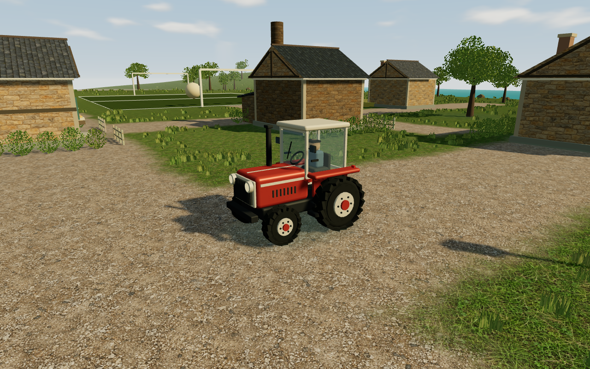
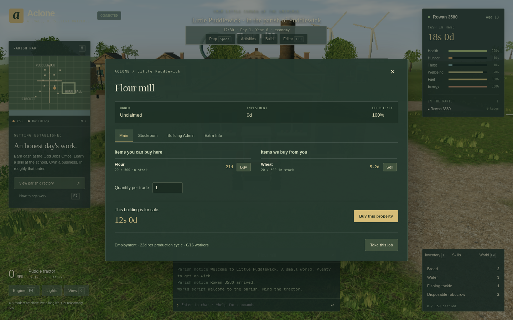
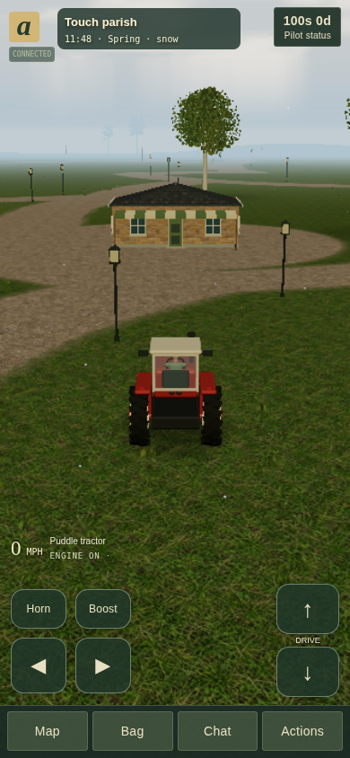
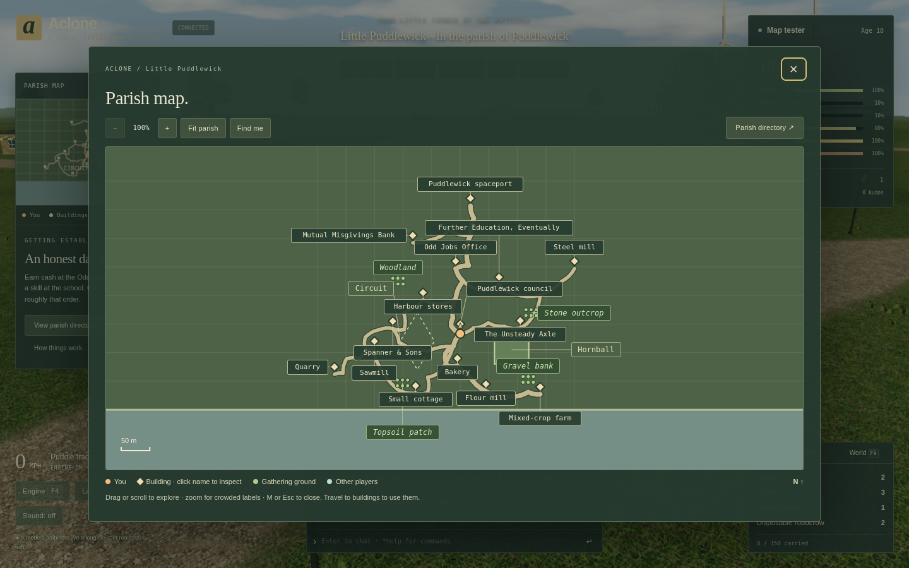

# Aclone

**A small, persistent universe with an unreasonable number of tractors.**

[Play the alpha](https://nogits.com/aclone/) · [Building gallery](https://nogits.com/buildings/) · [Player guide](docs/PLAYING.md) · [Release notes](docs/RELEASE_NOTES.md) · [Changelog](CHANGELOG.md)

**Version 0.103.0 · development alpha · GPL-3.0-or-later · Node.js 24.22.1+ (24.x LTS)**

Aclone is an independent, open-source browser game inspired by _A tractor / The Universal_. Drive, trade, farm, run a business, employ neighbours and build a home—or create a world with your own rules. It uses original code, models, textures and synthesized sound, with no dependency on the original game's servers or assets.



The 0.101.0 coastal update moves Puddlewick’s harbour light about 780 metres out of town and places all three public lighthouses on rocky bluffs. Twelve more headlands punctuate the island’s shore. Cliff edges stop walkers and tractors safely, and new lighthouses require a suitable cliff-top site. Rotating lights flash toward observers offshore, with height- and weather-limited visibility up to about 30 km; shafts appear only in misty rain or storms. Beach breakers roll and collapse, while cliff impacts throw up falling spray. Each lighthouse still offers one unskilled keeper job with private provisions and free quarters while employed; ownership alone does not provide housing. [Playing guide](docs/PLAYING.md#lighthouse-keeping).

Version 0.104.0 adds the Coastal Belle charter fishing boat and paid passenger trips, and fixes tractor lamp and beam visibility between players. See [release notes](docs/RELEASE_NOTES.md#01040--charter-fishing-trips-and-synchronized-headlights).

## What you can do

- Build an economy: gather materials, grow seven crops, raise visible cows, sheep, pigs and chickens, process feed/milk/cheese/meals/wool/eggs/compost, set prices/wages and run shops or guesthouses. Farm care uses stockroom supplies before personal materials. Puddlewick jobs persist offline and qualified owners can operate factories unpaid. Cancel unfinished construction for a partial cash refund. Supply rotating parish maintenance orders and read business statements and return reports; banks offer loans, mortgages and persistent credit histories.
- Live in a persistent world with seasons, storms, colourful dawns and sunsets, day/night lighting, survival and configurable automatic meals from inventory and home stores, online and offline. Puddlewick enables both, with 20% slower needs while indoors. An at-home indicator estimates when food or drink will run out, without counting starvation time. World owners can configure death penalties and inactivity limits. Configurable estates retain goods/capital and reprice unclaimed properties as equity and age change.
- Oceans have depth-faded underwater visibility, weather-driven swells and breaking surf. Boats rise and tilt with waves, and fast wave encounters produce spray and slow the hull. World owners can configure wave strength and moon-linked tidal ranges; Puddlewick uses a modest 0.6-metre spring range.
- Commercial fishing keeps an unhauled catch in the net when towing stops. Use **Deploy / resume nets** to restart fishing after refuelling, or **Haul catch & stow** to bring it aboard. Full nets and holds trigger an alert and a highlighted status, including with the fishing controls collapsed.
- Contextual controls show relevant vehicle/activity actions, explain seasonal planting limits, and separate personal property management from caretaker tools.
- Board biplanes at Puddlewick’s public airfield hangar and practise on its marked runway. Crashes destroy one aircraft and show fire, sparks and smoke; spare airframes remain available at the hangar.
- Choose among six distinct, individually paintable tractors with different cargo, speed, handling, tank and headlight strengths; preview and buy them at garages. Maintain vehicles with steel spare parts and garage or roadside service; optional world rules require advanced-vehicle licences and carried maps. Drive, fly, walk, fish, race, play Hornball/Ultrakricket, or join team combat and capture the flag. Combat-world creators can enable distinct robocrow classes with mark/recall abilities.
- Watch the spaceport cargo launcher depart with engine plumes and pad smoke every three or four game days and land half a day later. Choose cargo, courier, explorer or shielded spacecraft with distinct fuel/time tradeoffs and travel among seven star systems; visit other trusted, self-hosted galaxies with a persistent identity and separate local progress.
- Choose active-work, relaxed owner-operated, harsh-survival or combat/frontier rules, then customize them. Create worlds with terrain/heightmaps, drawn paths, surface painting, fences, model scatter, custom models, animated GLB/OBJ models, painted PNG/JPEG textures, environmental audio zones and portable media bundles, custom goods/professions/building templates, production-chain diagnostics, readable books, recurring town events, optional player-funded lotteries, visual behavior rules, ordered tutorials/quests, action requirements and optional Lua scripts with persistent player progress.
- Meet up to 19 optional AI neighbours with distinct personalities, memory and playing habits. All use Jev for decisions; Mabel chats through OpenAI, the others through Claude. Mabel stays in her home world to help neighbours and develop her settlement; other residents can travel. Address one directly by name, or use `@all` to invite one interested volunteer without a chorus of replies. Say “Mabel, stop responding” to end her public conversation; mentioning her while addressing another player does not summon her. API billing and operator spending limits are separate from consumer subscriptions. Developers can test survival and business growth in an isolated [accelerated Jev experiment](docs/NPCS.md#actual-jev-snapshot-experiments-paid), with explicit spending limits and resumable reports.
- Play with desktop controls or a compact touch interface. Mark map waypoints and follow camera-relative arrows and distance while driving. Maps show smooth shorelines; toggle 10-metre terrain contours with labelled 50-metre lines to read hills and valleys. Send private offline mail, form families by invitation, agree direct trades, give neighbours money or help service their vehicles.

People now use a continuous smooth mesh with recorded human walking and running motion, natural weight shifts and planted feet. Biplane keyboard pitch follows flight-stick convention: **Down pulls up; Up pushes down**. Reload after updating to load the new character and controls. See [release notes](docs/RELEASE_NOTES.md#0920--more-natural-people).

The Taxes & rates page (World/F9 or parish directory) explains live world and town rates, with included-tax totals beside shop trades.

Version 0.85 adds visible snow accumulation around tyres and vegetation without extra terrain polygons. HUD snow depths are centimetres: 4 cm is about 1.6 inches, and 11 cm is about 4.3 inches. Natural depths over six inches are exceptional; sunny weather gradually melts extra snow while roads stay exposed. Version 0.85.3 adds physical snow caps on roofs and fences, roadside banks, drifts around walls and trees, and depth-sensitive tyre-rut shading; 0.85.4 smooths road edges and fades the layers naturally during thaw. See [release changes](CHANGELOG.md#0854---2026-10-22) and the [weather rules](docs/PLAYING.md#time-and-weather).

Version 0.86 adds gradual road connections between towns and detours around buildings and fields, plus grounded hillside furniture, tractor tilt and clearer distant terrain. See [release changes](CHANGELOG.md#0860---2026-10-22).

Version 0.101.1 reduces scenery-loading pauses while driving by spreading terrain and woodland preparation across frames. It preserves terrain detail and snow shapes; reload the game to receive the update. See [release notes](docs/RELEASE_NOTES.md#01011--smoother-countryside-loading).

This is a playable alpha, not complete historical feature parity. See [status and limitations](docs/STATUS.md).

The [fidelity implementation plan](docs/FIDELITY_PLAN.md) tracks seven implementation passes from the Games For May research, with acceptance checks, results and outstanding validation. Version 0.78.0 adds controller menus, repeat gathering, business diagnostics, slope foundations, creator competitions and optional property contracts/maintenance. Contracts and round phases default off.

AI neighbours inspect shops, remember recent quotes, and can restore essential production through ordinary training, delivery and work. Accepted survival and career routines continue without AI credits; stocked-home targets, complete earning trips, costed surplus pricing and protected operating capital guide their choices; see [AI neighbours](docs/NPCS.md). Gameplay now includes protected gameplay budgets, complete structured decision options, persistent savings milestones and trade-price guards; see the [redesign handoff](docs/NPC_RECOVERY.md#2026-10-18-planner-redesign-0700).

NPCs share explicit financial facts between chat and planning and can carry out agreed price changes and surplus withdrawals; see [AI neighbours](docs/NPCS.md#agreements-made-in-chat). Long-term autonomous prosperity remains under evaluation. Version 0.96.2 repairs replenishment checks, funded staffing, business maintenance visits and project-linked surplus withdrawals; implementation and validation limits are described in [business continuity](docs/NPCS.md#business-continuity). The [recovery handoff](docs/NPC_RECOVERY.md) records the business/career and conversation-budget fixes, and validation still needed.

Design buildings before breaking ground: five trade-specific architectural models per building type with six independent finishes (paint colours for shipping-container caches), larger storage or lodging layouts for suitable types, a 3D preview at a fixed scale per type, and rotation with a north-up site plan. Material bills and town taxes reflect the selected design. Trade-specific equipment distinguishes businesses, and cottage mailboxes mark residences. See [building designs](docs/PLAYING.md#building-designs).

Roads and the starter town’s circular gravel square offer faster tractor travel than fields, with a modest advantage in dry weather and a stronger one on wet or snow-covered ground. Large worlds have rolling uplands around the settled town; tractors climb more slowly and descend faster, with a controlled speed bonus. Players and NPCs follow the same driving rules.

Grow hay, expand farms to sixteen plots, and run a high-capacity hay barn. Harvest crops before winter kills them; stored produce survives. Cattle and sheep eat hay or feed from their stockrooms; see [farming](docs/PLAYING.md#farming) and [livestock](docs/PLAYING.md#livestock-and-nutrition).

Automatic producers have ideal crew sizes: understaffing and overcrowding both reduce production speed. Owners can set paid-job limits, dismiss workers and compare potential margins per batch and per hour, separately from actual cash flow. Wages are paid when batches complete. Shop prices, stock and included taxes remain visible to owners; property listings can be withdrawn.

Bank and business cash transfers support up to 100,000d per action, subject to available funds and protected investment claims. Goods quantities and cargo capacity are separate limits.

The economy rebalance covers ideal crews, preserves operating reserves and adds paid surplus exports. Its one-time migration updates all standard Puddlewick business quotes and wages, including owned shops; ownership, goods and balances remain intact. See [economy rules and upgrade details](docs/ECONOMY.md#default-trade-prices).

Puddlewick has a premium government bread/water shop for shortages. Local production remains cheaper.

Employment has a visible shift countdown and renewal reminder; see the [economy guide](docs/ECONOMY.md).

Boats stop and recoil at the shoreline, with minor hull damage and an automatic throttle cut; release or reverse a held throttle key before moving again.

Shop rows show your carried quantities. Use **Sell all** to sell a stack, or **Sell max** to sell the quantity the buyer can currently afford and store. Repeated trades show cumulative confirmed quantities and costs, including after closing a shop.

The on-screen **Menu · F9** button opens maps, reports, settings and your pilot key. **F9 → Statistics** shows playtime (including recovered historical estimates), personal finances, completed construction, gathered materials, harvests and deaths; see [statistics coverage](docs/PLAYING.md#personal-statistics).

Puddlewick has a public fountain-and-benches town centre for local government; each town keeps its own meeting place. See [parish services](docs/PLAYING.md#puddlewick-services).

World owners can inspect residents, businesses and public notices through **F6 → Caretaker dashboard**. See the [caretaker history guide](docs/PLAYING.md#caretaker-history) for persistent public chat and notice archives.

<details>
<summary>More gameplay screenshots</summary>





[Full screenshot gallery and asset sources](docs/ART.md)

</details>

## Run locally

```sh
git clone https://github.com/151henry151/Aclone.git
cd Aclone
npm ci
npm run dev
```

Open **http://127.0.0.1:3000**. Development mode reloads client code. For a production build:

```sh
npm run build
npm start
```

State lives in `var/aclone.sqlite`; keep this directory between runs. For LAN access, start with `HOST=0.0.0.0 npm start` and use the host's LAN address. Native startup inherits environment variables; to load a private `.env`, use `node --env-file=.env --import tsx src/server/main.ts` (add `--dev` for development).

## Deploy

Use a single Node process per database behind an HTTPS reverse proxy, or `docker compose up --build -d` with its persistent volume. For a URL such as `https://hromp.com/aclone/`:

```sh
BASE_PATH=/aclone npm run build
PUBLIC_ORIGIN=https://hromp.com/aclone/ npm start
```

The proxy must strip `/aclone` before forwarding, including WebSocket requests, and redirect `/aclone` to `/aclone/`. See [hosting](docs/HOSTING.md) for proxy examples, environment variables, SMTP, backups and restore; [releasing](docs/RELEASING.md) covers upgrades. Production deployment is operator-managed; the nogits.com instance deploys with `scripts/deploy-nogits.sh` after `main` is pushed.

## Start playing

Drive with **WASD/arrows**, interact with **E/Ctrl**, open the map with **M**, inventory with **I**, and chat with **Enter** (sending retains focus; **Escape** returns to driving; focused buttons retain normal Enter activation). On mobile, use the steering/throttle buttons and **Actions** menu.

1. Work a 15-second Odd Jobs shift for 1d, or the displayed meal-relief rate when eligible.
2. Buy food and water at Harbour stores; Puddlewick consumes carried supplies automatically. Expensive emergency bread/water imports remain available when shelves are empty; local producers are cheaper.
3. Learn a profession at school, take a funded job or save to buy a business.
4. Stock inventory or your selected home/room before logging off. Puddlewick consumes those supplies automatically anywhere; go inside for 20% slower needs. Other worlds choose their own rules. **Hunger, thirst and starvation continue offline.**

Beer and wine can impair steering and produce scene sway, distortion and double vision; visual comfort controls are in **Pilot & preferences**. Buildings use distinct masonry, timber and metal finishes suited to their trade. Models share detail textures for siding, shop windows, machinery and animal coats to reduce geometry while retaining animated parts and night lighting. On entering a world, a short loading screen prepares scenery and lighting before driving controls become available. Set a password and, where mail is configured, verify a recovery email in **Pilot & preferences**. Keep your pilot key private; export a fresh one after password sign-in. See [controls and FAQ](docs/FAQ.md) and [player guide](docs/PLAYING.md) for details.

## Public website

The marketing page at [nogits.com](https://nogits.com/) lives in `website/`, separately from the game at `/aclone/`. Run `npm run preview:website` for a local preview, `npm run build:website` to generate `website-dist/`, and `CHROMIUM_PATH=/usr/bin/chromium npm run check:website` for responsive browser checks. The build includes the searchable [building gallery](https://nogits.com/buildings/) and reads the release version from `package.json`. Click a building sheet to rotate its orthographic 3D preview and compare models, finishes and sizes; mouse, touch and keyboard controls are supported. Refresh its rendered sheets with `npm run screenshots:buildings` (Chromium and ImageMagick required). The [art guide](docs/ART.md#building-architecture) also documents the all-finishes visual review sheets. See [hosting](docs/HOSTING.md#public-marketing-site) for publishing and screenshot refreshes.

## Contribute

Start with [CONTRIBUTING](CONTRIBUTING.md). Use tests for new behavior, keep money/state changes authoritative on the server, and update the relevant guide and changelog. No credentials, saved accounts or original-game research assets belong in commits or releases.

```sh
npm run check
npm run format:check
npm run build
npx playwright install chromium
# Start a disposable test server before browser tests:
npm run test:e2e
```

For graphics settings, open **F9 → Options & pilot key** and scroll below the sound controls. Adaptive mode reduces graphics when frame rates remain low; Performance mode targets 30 FPS. A Performance-mode reload button is also available while loading.

Version 0.99.0 adds moon-linked tides, weather-driven ocean swells and boat motion, wave-impact spray and resistance, shoreline surf, and depth-faded underwater visibility. World owners can tune tides and waves. Reload after deployment; Puddlewick enables a modest 0.6-metre tidal range. See [boating](docs/BOATING.md#ocean-weather-and-tides).

Version 0.98.0 rebuilds the commercial trawl with a complete submerged net, spreading boards and staged hauling animations. Water is clearer when viewed from above, and full nets/holds produce explicit alerts. Reload to load the update; catches, fuel and fishing economics are preserved.

Version 0.97.0 adds a switchable topographic map with 10-metre contours and labelled 50-metre lines, plus smooth shorelines on both maps. Reload after deployment; the island terrain and driving behaviour are unchanged.

Version 0.96.3 fixed small position pullbacks on server updates and unnecessary skipped frames from display-timing jitter. Reload after deployment to load the smoother movement. Movement regression checks include steady-speed driving with server updates arriving between 30/60 FPS frames, delayed network traffic, and frame scheduling on 60/120/144 Hz displays. These check motion consistency as well as average frame rate.

Collision regression tests cover driving out of overlapping worksite walls and equipment yards, including rotated models, without passing through neighbouring buildings.

Production builds include precompressed client files; deploy the entire `dist/` directory. See [hosting and performance](docs/HOSTING.md#connection-and-multiplayer-checks) for cache behavior and startup diagnostics.

CI runs unit/type/format checks, eight isolated browser shards, public-website checks, and deployed-build checks under `/aclone/`. Gameplay browser tests wait for the startup overlay to disappear before sending controls; the HUD alone is visible during settling. Use the startup test for input-during-loading behavior. Flight physics tests include a complete takeoff, controlled approach, landing and stop with delayed discrete controls. See [browser-check guidance](CONTRIBUTING.md#ci-browser-checks) for timing and teardown troubleshooting.

Browser tests may create pilots and worlds: never target production. `TEST_URL` selects the server; `CHROMIUM_PATH` selects an installed Chromium. People use a continuous smooth body mesh with skeletal walking/jogging animation adapted from recorded human motion and a shared workwear/face texture. Preview the actual model and seated pose with `npx tsx scripts/walking-preview.ts`; it writes 30-fps frames and front/back/side/seated views into `output/walking/`. Rebuild its baked surface with `npx tsx scripts/human-mesh.ts` and motion clips with `npx tsx scripts/human-motion.ts`; [motion provenance](art/motion/README.md) credits the CMU capture data. Load/network checks are in [Hosting](docs/HOSTING.md#connection-and-multiplayer-checks); visual capture commands are in [Art](docs/ART.md#reviewing-visual-changes).

The [offline NPC evaluator](docs/NPCS.md#household-and-career-recovery) can fast-forward a disposable economy without graphics or API charges. Use it to find mechanical failures; its heuristic decisions do not prove that the live AI economy is stable.

Release maintainers can use the optional [Discord changelog publisher](docs/RELEASING.md#discord-changelog-publisher) to backfill one post per release and publish new dated entries after deployment. It runs on the game host with a protected bot token and a systemd timer; your laptop need not stay online.

## Documentation

### Players and world creators

- [Playing](docs/PLAYING.md) — getting started, activities, farming, travel and survival.
- [Controls and FAQ](docs/FAQ.md) — key bindings and quick troubleshooting; also used by NPC help.
- [Mobile](docs/MOBILE.md) — touch controls, menus and device checks.
- [Economy](docs/ECONOMY.md) — prices, production chains, materials and lodging.
- [World building](docs/WORLD_BUILDING.md) — creator studio, custom models, rules and design transfer.
- [Illustrated world-building guide](docs/WORLD_BUILDING_GUIDE.md) — step-by-step editor tutorials with 18 screenshots; also published at [nogits.com/world-building](https://nogits.com/world-building/).
- [Scripting](docs/SCRIPTING.md) — Lua events, effects, examples and limits.

### Hosts and developers

- [Fidelity implementation plan](docs/FIDELITY_PLAN.md) — staged improvements from historical research, dependencies, validation and progress.
- [Hosting](docs/HOSTING.md) — installation, HTTPS, email, backups and capacity checks.
- [Connected galaxies](docs/GALAXIES.md) — cross-server visits, trust and recovery.
- [NPC recovery implementation](docs/NPC_RECOVERY.md) — audit fixes, verification and deployment handoff.
- [AI neighbours](docs/NPCS.md) — setup, personality/memory, schedules, budgets and diagnostics.
- [Architecture](docs/ARCHITECTURE.md) — code map, authority, persistence and rendering boundaries.
- [Data](docs/DATA.md) — catalogs, units, saved fields and tuning.
- [Protocol](docs/PROTOCOL.md) — HTTP, actions and WebSocket snapshots.
- [Art](docs/ART.md) — models, rendering budgets, captures and screenshot gallery.
- [Texture prompts](docs/TEXTURE_PROMPTS.md) — original generation prompts and source provenance.
- [Status](docs/STATUS.md) — supported systems, limits and remaining fidelity work.
- [Releasing](docs/RELEASING.md) — checks, packaging and deployment procedure.
- [Release notes](docs/RELEASE_NOTES.md) — historical features, migrations and validation records.

## License

Code, configuration, documentation and original generated art/audio are **GPL-3.0-or-later**, unless a file says otherwise. See [LICENSE](LICENSE), [COPYRIGHT](COPYRIGHT), [third-party notices](THIRD_PARTY_NOTICES.md) and [security policy](SECURITY.md). Contributions use the same license.

_A tractor / The Universal_ belongs to its creators; Aclone is independent and not endorsed by them. The supplied spec and `sources/` are research, not relicensed assets, and are excluded from the client and release archive. The World Owners' Manual is attributed in the research spec; these guides use original wording.

### Tractor fleet

Each owned machine can have its own saved paint colour; the garage preview shows
the selected tractor’s finish. Repainting one leaves the others unchanged.
First-person cockpits have textured interiors and working speed, fuel and condition
gauges, with illuminated instruments, rounded dashboard tops and correctly tilted steering wheels.
The seated view follows the tractor’s pitch and roll on hills, with mouse look relative to the cab.

The [tractor fleet guide](docs/TRACTORS.md) covers tractor dimensions, cockpit controls and five specialist tractors alongside
the reworked starter, with a garage model viewer and balanced trade-offs. Choose
compact handling, express deliveries, bulk hauling, rough-ground traction or
long-range night work; each machine has its own tank and saved finish.

### Biplane

Fly a paintable, fabric-covered mail plane with an open cockpit, braced wings,
landing gear and an animated wooden propeller. Cockpit instruments show airspeed, attitude, altitude, heading, climb rate, RPM
and fuel; see the [flying guide](docs/FLYING.md) for controls and ground handling, and [aircraft art notes](docs/ART.md#biplane).

Two-handed flight controls, takeoff/landing physics and stalls make flying a skill
to practise. See the [flight guide](docs/FLYING.md) for controls, cockpit instruments,
safe approaches and crash consequences.

### Boats and fishing

Boathouses also sell **Fishing tackle** (rod-and-line equipment).
Puddlewick’s public boatyard restocks a small shelf using its till; private owners
set their own prices and arrange their stock.

The paintable Parish Carrier canal boat has a rounded hull, curved cabin roof,
timber decks and a stern tiller. It has automatic navigation lights and switchable
deck/cabin lighting, including illuminated cabin windows. Its 240-weight hold and three passenger places
suit coastal hauling. Buy and board boats at a shoreline **boathouse**; owned
boats also board at the fishing pier. Pier departures leave an empty moored boat;
boathouses store boats inside. Their covered lifting halls extend over the water,
and each of five architectural models has its own set of repair boats on stands.
Return to a dock to disembark. There is no offshore
teleport to land. Boats can sail through connected water to the map boundary.

**Coastal Belle charter boat.** A separate 120s,
15-metre passenger fishing boat adds six places, a 600-weight captain's hold and a
192-unit tank. Its enclosed helm has a live compass, fuel/speed gauges and a
persistent W/S throttle (B idles). Use Inventory → Boating at a dock to invite
players for an agreed fare and 15–180 real minutes including travel. Passengers
accept on shore, bring their own tackle and provisions, and keep their catches.
Stop before they cast; moving reels in their lines. Fare is held in saved escrow
until return: early return pays proportionally, cancellation or return to a different
dock refunds all. Death cancels affected bookings; existing world boat-death rules
still apply. No overtime charge or offshore disembarking. Lighting switches remain
under Lights. See [charter design and balance](docs/CHARTER_BOAT.md).

The **North Star fishing boat** has a persistent throttle and working
nets. Boatyard landing prices leave margins for hauliers delivering cod, halibut
and tuna to food businesses or export terminals; kitchens and guest accommodation
can select seafood recipes.

Fishing includes continuous catches hidden until hauling, long offshore expeditions,
voluntary deckhands and shared provisions. The North Star costs 300s, with a 3,200-weight hold and 3,200-unit tank; at Puddlewick’s
clock speed, that supports 21 game days (3½ real hours) of towing plus transit.
The canal boat costs 24s. A complete trawl rig has spreading boards, floats and a
closed catch bag, with animated pay-out, towing, retrieval and deck unloading. Fish
activity and deck piles remain coarse visual cues;
fuel and cargo load affect performance. Ocean expansion preserves the existing
island and properties. The revised wheelhouse includes a mounted compass and live
marine instruments, a throttle lever, chart desk and furnished cabin, with readable
instrument faces at night. Boatyards also accept stopped arrivals within 30 metres
of their water berth, and ocean rendering follows boats far offshore.

Buy or board boats from dry land within 40 metres of a
boathouse, matching its building-menu range. Fishing-pier boarding still uses the
marked boarding point. See [boarding and mooring](docs/BOATING.md#boarding-and-mooring).

Boat navigation uses steady marine signals, with separate deck/cabin/searchlight
controls, a collapsible fishing HUD and a camera that stays above the ocean surface.
The fishing panel sits above the driving readout, keeping speed and network/FPS
information clear whether expanded or collapsed, including on mobile screens.
**Puddlewick removes all owned boats and everything aboard on death.** World owners
can instead allow offshore recovery, set a cargo-spoilage deadline (five game days
by default, or zero for no expiry), and choose whether tank fuel survives.
Recovery passengers can hitch a ride on another player's boat and transfer back
when stopped alongside their stranded vessel. See the [boating guide](docs/BOATING.md).

An empty tank unlocks the **orange rowed lifeboat**. Main cargo stays offshore;
row to a dock, buy fuel, then row back to reboard and refuel. Boats, moorings and
rescue progress persist. Rod fishing from a stopped boat can also catch the new
species in deep water. See the [boating guide and balance notes](docs/BOATING.md)
and [art notes](docs/ART.md#canal-boat) for controls, costs and model details.

### Hovercraft

The Marsh Courier hovercraft has a rubber skirt, enclosed cockpit, guarded rear
fan and cargo lockers, with working speed/fuel instruments and individual paint.
See [the art notes](docs/ART.md#hovercraft).
