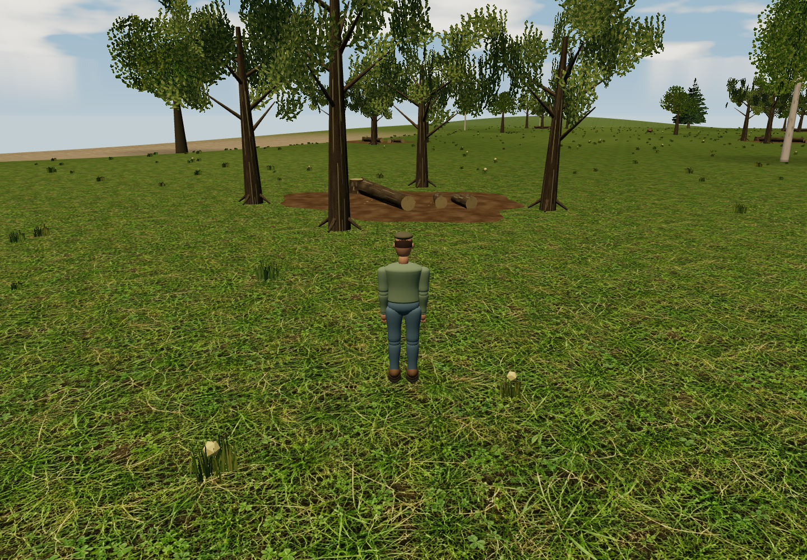
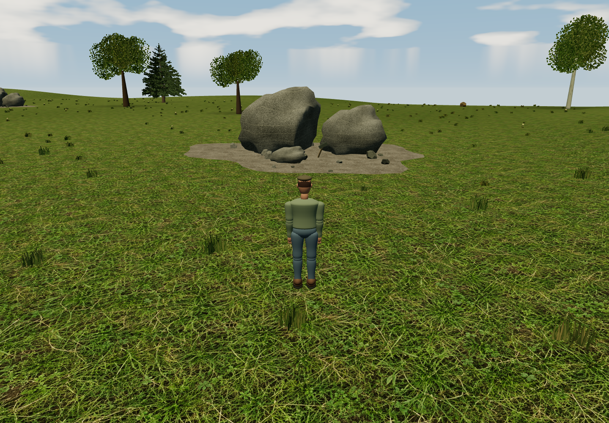

# Art and visual verification

Warm, weathered countryside, readable machinery and consistent metre-scale forms. Original-game screenshots informed direction; none of their pixels/models ship. Original procedural geometry, sounds and generated textures use GPL-3.0-or-later. [Texture provenance/prompts](TEXTURE_PROMPTS.md) preserves exact generation instructions and master-export commands.

## Building architecture

`shared/building-architecture.ts` defines five models for each of 48 built-in types. `shared/building-recipes.ts` supplies distinct premises for 42 types, with explicit dimensions and layouts appropriate to each trade; containers, pump houses, spaceports and small props retain specialist generators. Structural volumes drive rendering, collision, placement and navigation; finishes are independent. Expansions add wings or floors. `shared/building-facade.ts` coordinates entrance, canopy, sign and window clearances; `client/building-architecture.ts` renders them and type-specific machinery; `shared/building-features.ts` reserves equipment yards for refinery columns, brewing kettles, mine headgear and other trade cues. Small painted symbols and clock faces use shared 128-pixel textures; cottages have post-mounted mailboxes. `client/shipping-container.ts` uses textured corrugation with simple frame/locking bars. Models stay below 3,500 triangles, except the spaceport with its existing rocket (30,000 budget). Textures remain shared; no new lights or animation loops.

The public [building gallery](https://nogits.com/buildings/) shows every type. Click a sheet for an interactive orthographic preview of the real model, with model, finish and size selectors. Drag to orbit, scroll or pinch to zoom, or use the labelled buttons. Arrow keys rotate the focused preview; +/− zoom, Home resets and Escape closes. The spaceport opens on its terminal, with a toggle to include the launch pad and rocket. Scale stays fixed across model, finish and size selections; previews render only when changed and release their renderer when closed. `npm run screenshots:buildings` refreshes its committed WebP sheets; `npm run build:website` builds the searchable page.

The designer uses one reference camera scale per building type. Run `npx tsx scripts/building-architecture-preview.ts` for same-scale model contact sheets in `output/building-architecture/`; spaceport sheets show the terminal campus without the distant rocket. Buildings without a saved model choice keep their legacy architecture, except containers. Existing model choices use the revised geometry without changing their location, stock, capacity or saved construction bill.

For a complete visual sweep:

```sh
GALLERY_QC=1 SCREENSHOT_OUTPUT_DIR=output/building-qc CHROMIUM_PATH=/usr/bin/chromium npx tsx scripts/building-architecture-preview.ts
```

Each sheet shows five models × six finishes, five rear views and one largest-size view at a common scale. Inspect roof joins, equipment supports, signage, windows and entrances as well as each trade’s silhouette. These use the real renderer in a temporary world without live data or model calls. Geometry tests cover all models, finishes and sizes, with regressions for signage clearances, clock towers, upper windows and container orientation.

## Rolling countryside

`shared/terrain.ts` blends broad downs and smaller rolling shoulders beyond the original 500m village square. Lower noise octave counts keep sampling inexpensive; smaller islands use lower relief, and harbour foothills prevent steep banks. Render tiles, maps, resource positions and authoritative movement use the same height function. Custom heightmaps override generation. `npx tsx scripts/hills-preview.ts` captures real game views in a disposable world under `test-results/hills/`.

## Natural gathering grounds

`client/resource-scenery.ts`: a grove/felled tree/firewood, chipped boulders/spalls, gravel hollow/wheelbarrow and exposed soil/roots/shovel. Original procedural bark/grain/foliage/rock/soil textures; shared seasonal materials, terrain-following geometry, clear surrounding vegetation. Stable variants use ≤5 batches and <5,000 detailed triangles/site, fewer in Performance.

`shared/resources.ts` places 24 grounds ≥20m from road edges, ≥35m from starter centres, ≤150m from a road. Map/HUD/NPCs share coordinates. Stable IDs preserve reserves/regrowth/tasks; custom terrain/buildings can obstruct sites. Client/server must update together. `tests/resource-scenery.test.ts` checks geometry, placement/navigation and save compatibility.




## Industrial robocrows (0.19.0)

`client/robocrow.ts`: 5.2m mechanical wings, overlapping feathers, actuators/spars, ducted fans, camera lenses, vents, fasteners, battery, split tail, claws and asymmetric service cover/antenna. Seven body draws + two rotating fans, 6,228 triangles; no extra lights/downloads/per-frame allocation. Used by local/remote and custom robocrow-mode slots; gameplay unchanged.

## Industrial spaceport (0.19.0)

`client/spaceport.ts`: ~193m cargo launcher (six times its earlier size), 120m apron, asymmetric panels/plumbing, ~158m truss/umbilicals, service tank, five engine bells and hydraulic legs. Crew hatch stays 2m. The industrial terminal adds cargo, control and utility wings. Shared materials join static batches; the launch kit remains below 45,000 triangles without new lights or animation. Shared footprints keep solid hardware and the walkable pad inside the starter map.

Shared collision/picking covers rocket/tower/tank; apron is walkable, label/entrance stay at terminal. Trapped saved pilots can move outward. The rocket is scenery: terminal Take off handles travel. [Day](screenshots/industrial-spaceport-day.png), [night](screenshots/industrial-spaceport-night.png).

## Spaceport apron (0.18.0)

Historical design, replaced in 0.19.0: 10m lathed retro hull, fins, struts/nozzle, blue windows and teal/orange livery; circular marked pad, gantry, amber emissive beacons and metal terminal cladding. Static original geometry without extra dynamic lights; shared footprint left the pad walkable. [Archived day](screenshots/spaceport-day.png), [night](screenshots/spaceport-night.png).

## Synthesized sound

`sound-synthesis.ts` generates mono PCM diesel pulses/harmonics/noise, two-tone horns and saw/mill/hammer/furnace/pump loops; cached/loop-blended per AudioContext. `audio.ts` ramps gain/rate, pans, applies saved master volume and compresses crowds. No external samples/licenses.

`sound-scene.ts` caps 16 continuous voices +8 horns (brief fading tails may overlap); engine/horn/industry ranges 110/150/90m. Listener follows displayed player position and camera direction, not zoom height; remote sounds interpolate with models. Indoors muffles outside; no geometric wall occlusion. Server `sound-state.ts` shares production predicates. Honks baseline on arrival/while muted, preventing replay. Gesture-unlocked contexts allocate only audible sources. Browser audio tests measure mixed PCM after compression with real remote sockets.

## Night sky

`starfield.ts`: seeded atlas of 4,600 varied-magnitude/color stars. `sky.ts`: procedural cratered lunar discs shaded from normals/sun, behind the same clouds in one draw. `astronomy.ts`: fictional 45°N observer, 23.4° tilt, 365-day year, 28-day synodic and five-day mutual moon cycles. Lunar radii 1.1°/0.56° exaggerate readability. Shared calendar preserves continuity. Moonlight reuses the sun light; `sky-weather.ts` samples matching cloud texels. Cloud coverage and shading use a curved-layer projection with continuous horizon perspective, avoiding stretched vertical texture columns; it adds no geometry or noise samples. Not an N-body or recovered historical model.

## Evergreen woodland

`evergreen.ts`: three seeded spruce/fir profiles, curved tapering trunks, staggered drooping boughs, lateral shoots and terminal sprays. Canvas needles/axes and fissured bark need no downloads. Twisted crossed alpha-tested planes avoid sorting; modest backlight uses scene lights, not glow. Seasonal shader cache identity is preserved; green autumn needles gather snow on top.

At most six instanced meshes (wood/needles per profile), <11,000 triangles/tree detailed; Performance removes secondary sprays/reduces branch segments to <80%, keeping trunk/bough layout. Seeded size/lean/rotation varies trees; grove/deciduous/grass placement remains stable.

## Renderer conventions

- `materials.ts` owns shared maps for page lifetime; disposal must preserve them. URLs respect BASE_PATH. Four WebPs total ~2.7 MiB; full PNG masters ship in source archives, not browser bundles.
- Metre-based UVs; albedo luminance gives uncalibrated bump. Meadow repeats at 5m, gravel 6m, noisy verge/shore transitions following shared roads.
- `noise.ts` precomputes noise; `sky.ts` uses it for clouds/halo. `scenery.ts` seeds instanced grass/leaf cards/trees/gardens/contact shade, keeping routes/sports clear; incidental scenery has no authoritative collision/economy.
- `tractor.ts` batches body/animated axles and seats `human.ts`; normalize indexed/non-indexed geometry before merging. Opaque batches key on texture/surface, not just color; glass stays separate.
- Contact shade remains without dynamic shadows. Antialiasing is detailed-only; software fallback can reduce cost without recreating WebGL. Dynamic shadows default off, separately opt-in outside Performance.

## Human figures

`human.ts` supplies an original continuous, watertight workwear character, replacing intersecting primitive body parts. `scripts/human-mesh.ts` bakes a smoothly joined implicit sculpt into `client/generated/human-mesh.json`; no meshing runs in the browser. The 10,228-triangle surface has a single connected shell, smooth normals and shared skin weights across UV seams. `human-surface.ts` supplies one shared clothing/face texture: pockets, stitching, buttons, boot laces and facial details add no geometry. No scanned likeness or third-party model downloads.

Walkers use an independently cloned 17-bone skeleton over shared geometry/materials. `human-gait.ts` blends recorded walking and running from the CMU Graphics Lab Motion Capture Database, retargeted offline by `scripts/human-motion.ts`. Real weight shifts, hip/shoulder counter-motion, elbow timing and knee recovery replace a uniform sine-wave cycle. See [motion sources and permission](../art/motion/README.md) and [third-party notices](../THIRD_PARTY_NOTICES.md) for attribution.

Distance drives stride phase; speed adjusts stride length and blends walk/run. Separate waist, neck and wrist joints carry overlapping movement. Two-bone leg constraints retain restrained captured knee variation without allowing backwards knee bends, keep soles above ground and hold feet during the loaded part of a step, including turns. Moving and idle poses blend on start/stop; reverse travel mirrors the step direction. This is a visual rig, not a change to player physics. Ground contact is relative to the character's ground plane; per-foot sampling of uneven terrain is not yet implemented.

Walkers and seated drivers each use one material draw; seated drivers bake the same surface into a static pose and do not keep a live skeleton. Skeleton GPU textures belong to each walker and are disposed when it leaves the scene. First-person hides local occupants; eye height 1.68m. Respect shared-resource flags on disposal.

Regenerate the sculpt with `npx tsx scripts/human-mesh.ts` and the clips with `npx tsx scripts/human-motion.ts`. Capture walking, jogging, front/back/side and seated views with `npx tsx scripts/walking-preview.ts`. `HUMAN_PREVIEW_PROFILE=true` selects a side view, and `HUMAN_PREVIEW_TRANSITIONS=true` adds start/walk/stop/reverse frames. Tests check surface connectivity/watertightness, matching weights at UV seams, independent animation, foot contact/clearance and rendering budgets.

## Scale and architecture (0.3.4)

One unit = 1m. Adult ~1.8m; tractor 2.85m high/2.6m wide, cockpit eye 2.5m; seated humans retain scale. Doors 2.1m, cottage/two-storey eaves 2.7/5.4m, workshop doors 3.2m, lamps 4m, bench seats 0.5m, mature trees 7–15m. Stylized proportions, not manufacturer replicas.

`shared/building-shapes.ts` supplies deterministic volumes for render/collision/picking/clearance; variants depend on stable IDs. `buildings.ts` supplies roofs/wings/joinery/awnings/bays/mill wheel and civic/industrial silhouettes. UVs retain metre tiling; details join static batching. Check first-person after seat/cab changes.

## Seasonal and customization work (0.4.0)

`appearance.json` defines cottage siding/paint; saved styles select board seams/gables. Chimney tips are model emitters; occupancy is authoritative, smoke visual. Seasonal uniforms affect terrain/upward surfaces/foliage; sun/sky share trajectory. Bounded rain/snow/smoke pools, four-stage instanced crops and one bounded projectile draw avoid per-frame allocations.

## Living villages (0.5.0)

Merged window panes have separate emissive control. Twelve pooled window/street spotlights (four Performance) aim outward/down without extra shadows; budgets do not scale with players. Distant streetlamps share one additive ground-glow mesh. Its fog shader attenuates light toward black so coloured fog cannot expose rectangular mesh edges; no additional lights or draw calls are needed. Dark nights retain headlights/natural sky light. Lightning combines cloud flash/bolt. Seed regions group evergreen/birch species; birches have procedural markings/narrow crowns and varied sizes.

## Reviewing visual changes

Use disposable worlds, never concept art presented as screenshots. `CHROMIUM_PATH` chooses Chromium. Captures default to SwiftShader; `SCREENSHOT_GPU=1` selects supported hardware and reports the actual device. `SCREENSHOT_QUALITY=low|balanced|high` selects Performance/Adaptive/Detailed; `SCREENSHOT_OUTPUT_DIR` changes output. Software timings do not predict GPU performance.

- `TEST_URL=... npm run screenshots`: creates pilot/world, checks browser errors, captures game/trade/editor. `SCREENSHOT_HERO_ONLY=1 SCREENSHOT_QUALITY=high` captures H-key scenery only.
- `npx tsx scripts/walking-preview.ts`: deterministic frames of the actual walking/jogging rig in `output/walking/`; encode `frames/%04d.png` at 30 fps for a motion preview. `tests/human-animation.test.ts` covers clone isolation, draw/triangle budgets, foot clearance and stopping.
- `npm run screenshots:characters` and `npx tsx scripts/streets.ts`: disposable TEST_URL server, real walking/driver/cottage/pub/mill/shop/school/scale actions.
- `npm run screenshots:town`: isolated expanded-town/service-access check.
- `npm run screenshots:seasons`: owned disposable server, staged dates/crops, real harvest and space actions.
- `npm run screenshots:living`: booking/gathering and night/headlights/snowstorm comparisons.
- `npm run screenshots:resources`: all four grounds and HUD gathering; defaults `test-results/resources`.
- `npx tsx scripts/evergreens.ts`: seeded real-tree front/side/close/distant/snow views, errors/render counts; defaults `test-results/evergreens`.
- After build, `npx tsx scripts/night-lighting.ts`: real L toggle, midnight/day and rainy sunrise/sunset comparisons; defaults `test-results/night-lighting`.
- `npx tsx scripts/night-sky.ts`: full/half/crescent/overcast/day, two hours' movement, same ground under moon/stars/cloud; defaults `test-results/night-sky`.
- `npm run test:e2e -- tests/browser/spaceport.spec.ts` and `tests/browser/robocrow.spec.ts`: real takeoff/dock scale and drone deployment/flight/return; `TEST_GPU=1` requests hardware.

Check driving-height and distant views, terrain edits, UVs/road edges, all cameras, root and `/aclone/` builds, both graphics modes. Canvas `data-draw-calls`/`data-triangles` expose counts. Textures should load once, not per snapshot. Captures fail on browser errors; geometry tests guard finite vertices/budgets/layout. Script-specific output directories live under `test-results/` unless overridden.

## Screenshot gallery

Actual renderer captures; many use staged disposable worlds. They demonstrate visuals, not production deployment. NPC chat capture uses a scripted reply; historical live API trials are in [release notes](RELEASE_NOTES.md#historical-npc-provider-trials).

- [Character](screenshots/character.png)
- [Cottage](screenshots/cottage.png)
- [Crescent moons](screenshots/crescent-moons.png)
- [Dark countryside](screenshots/dark-countryside.png)
- [Dock fishing desktop](screenshots/dock-fishing-desktop.png)
- [Dock fishing phone](screenshots/dock-fishing-phone.png)
- [Driver](screenshots/driver.png)
- [Editor](screenshots/editor.png)
- [Evening inn](screenshots/evening-inn.png)
- [Evergreen close](screenshots/evergreen-close.png)
- [Evergreen](screenshots/evergreen.png)
- [Farm plots](screenshots/farm-plots.png)
- [Farming](screenshots/farming.png)
- [Galaxy routes](screenshots/galaxy-routes.png)
- [Galaxy](screenshots/galaxy.png)
- [Gather hud desktop](screenshots/gather-hud-desktop.png)
- [Gather hud phone](screenshots/gather-hud-phone.png)
- [Gathering](screenshots/gathering.png)
- [Guesthouse](screenshots/guesthouse.png)
- [Headlights](screenshots/headlights.png)
- [Human scale](screenshots/human-scale.png)
- [Industrial robocrow](screenshots/industrial-robocrow.png)
- [Industrial spaceport day](screenshots/industrial-spaceport-day.png)
- [Industrial spaceport night](screenshots/industrial-spaceport-night.png)
- [Lodging](screenshots/lodging.png)
- [Mill](screenshots/mill.png)
- [Mobile landscape](screenshots/mobile-landscape.png)
- [Mobile portrait](screenshots/mobile-portrait.png)
- [Moonlit ground](screenshots/moonlit-ground.png)
- [Night town](screenshots/night-town.png)
- [Npc chat](screenshots/npc-chat.png)
- [Parish map](screenshots/parish-map.png)
- [Parish](screenshots/parish.png)
- [Pub](screenshots/pub.png)
- [Scenery](screenshots/scenery.png)
- [School](screenshots/school.png)
- [Shops](screenshots/shops.png)
- [Snowstorm](screenshots/snowstorm.png)
- [Spaceport day](screenshots/spaceport-day.png)
- [Spaceport night](screenshots/spaceport-night.png)
- [Sprawling town](screenshots/sprawling-town.png)
- [Starlit ground](screenshots/starlit-ground.png)
- [Stone outcrop](screenshots/stone-outcrop.png)
- [Sunset](screenshots/sunset.png)
- [Task countdown desktop](screenshots/task-countdown-desktop.png)
- [Task countdown phone](screenshots/task-countdown-phone.png)
- [Town overview](screenshots/town-overview.png)
- [Trading](screenshots/trading.png)
- [Twin moons](screenshots/twin-moons.png)
- [Village](screenshots/village.png)
- [Walking](screenshots/walking.png)
- [Winter](screenshots/winter.png)
- [Wood cottage](screenshots/wood-cottage.png)
- [Woodland clearing](screenshots/woodland-clearing.png)
- [Woodland](screenshots/woodland.png)

## Livestock

Original articulated cow, sheep, pig and chicken meshes use smooth anatomy, procedural coat/fleece/feather detail and shared instanced rendering. No downloaded animal assets. `CHROMIUM_PATH=/usr/bin/chromium npm run screenshots:livestock` captures close-ups of the actual meshes with preview lighting in `test-results/livestock/`; the browser livestock test captures the live game.

## Geometry and texture budgets

Grilles, tread, wheel bolts, doors, siding and window frames use cached procedural textures. Window emissive masks keep frames dark and panes lit. Animal coats share one atlas; limbs remain separately animated. No per-frame texture generation or extra downloads.

`npm run profile:models` measures triangles before scenery batching: tractor with driver 14,262 (formerly 29,824); cow 5,704, sheep 3,916, pig 4,156 and chicken 4,044 (formerly 13,464–15,768); sample cottage 248 (formerly 1,514). These geometry counts are not FPS promises. `CHROMIUM_PATH=/usr/bin/chromium npm run screenshots:models` captures tractor/cottage/day/night close-ups in `test-results/models/`. Preview lighting includes shadows; game shadows remain optional.

Cow anatomy is baked from original blended volumes by `npx tsx scripts/cow-surface.ts` into `src/client/cow-surface.json`; run Prettier after rebaking. Torso and legs share a closed surface, with weighted vertex deformation for walking. `npm run screenshots:livestock` includes a side view. Reference photographs guide proportions only; no reference pixels are shipped.

### Biplane

`src/client/biplane.ts` replaces the built-in aircraft's box primitives with an
original civilian mail-plane design. A tapered shell has a real opening for the
pilot, staggered wings have shaped tips and a cockpit cutout, and the undercarriage
uses a tail-down resting stance that levels off after leaving the ground. Bracing,
landing gear, windscreen, padded cockpit rim and propeller are simple geometry;
fabric weave, rib tapes, seams, registration, radiator fins, wood grain and instruments
are cached canvas textures. Garage paint tints the fabric and fuselage while retaining
the dark trim. Creator-supplied models still override the built-in aircraft.

The propeller stops when the engine is off. Only the visible local cockpit updates
its instrument texture, at most ten times a second, with airspeed in mph, attitude,
altitude in metres above sea level, heading, climb rate and throttle-derived RPM.
Fuel and height above ground remain visible. The moving yoke and throttle quadrant
use separate material batches; gauges and needles are drawn into one canvas texture.
The seated eye and camera up-vector follow pitch and bank without detaching from the
cockpit. The current development model has 12,306 triangles and 19 meshes including
the pilot. These are geometry budgets, not FPS guarantees. See [Flying](FLYING.md)
for the accompanying physics and controls.

Run `npx tsx scripts/biplane-preview.ts` for front, rear, side, overhead and seated
views plus a review sheet in `output/biplane/`. The focused browser check is
`npm run test:e2e -- tests/browser/biplane.spec.ts`.

### Hovercraft

`src/client/hovercraft.ts` builds the Marsh Courier, a small enclosed utility
hovercraft with a continuous rounded skirt, sloped windscreen, cargo lockers,
rear duct, safety mesh and turning fan. Rubber folds, panel seams, maker lettering,
non-slip deck pattern and instrument faces use cached textures. The fan guard is
an alpha-tested texture rather than a lattice of individual geometry. Each craft
retains independent garage paint; creator-provided models still take precedence.

The model accounts for the physics engine's 0.5-metre hover offset, leaving its
skirt just above the surface. Static geometry is batched by material. Including
the seated driver, it stays below 15,000 triangles and 24 meshes. These budgets
are not a measured FPS guarantee. Speed, cargo capacity, fuel use and water/land
handling are unchanged. The engine controls the fan; only the visible local
cockpit updates its speed/fuel texture, at most four times a second.

Run `npx tsx scripts/hovercraft-preview.ts` for actual factory renders and a review
sheet in `output/hovercraft/`. Run `npm run test:e2e -- tests/browser/hovercraft.spec.ts`
for paint, engine animation, skirt normals, ground clearance, instrument updates
and geometry-budget checks.

### Building finishes

`building-finishes.ts` supplies shared 512px masonry, timber, plaster and roofing maps plus 256px door, awning and window details. Profiles distinguish food shops, civic buildings, agricultural sheds and industry; existing stone and cottage siding remain in use. Brick joints, grain, fasteners, shutter ribs, bread displays and leaded glass are baked into textures. Roof courses follow the eaves and corrugations run downhill. Original footprints and cottage style choices are unchanged.

No building gains triangles. For the preview IDs, garage 366 → 58, farm 574 → 84 and bakery 610 → 346; the cottage remains 248. The finite texture library is generated once, shared across buildings/rebuilds and mipmapped; its base RGBA data stays below 11 MiB (mipmaps add about one-third). Window quads retain their existing emissive mask and light batching. More material families can add static material batches; geometry savings are not an FPS guarantee.

`CHROMIUM_PATH=/usr/bin/chromium npx tsx scripts/building-preview.ts` captures the actual bakery, bank, school, garage, farm, pump house, mill and cottage in `test-results/buildings/`, with browser-error checks. `tests/building-finishes.test.ts` checks geometry budgets, texture reuse, cottage customization and window batching.
