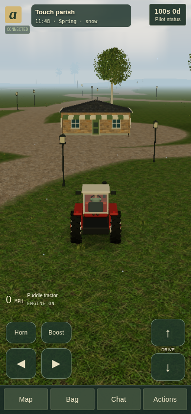

# Playing on a phone or tablet

Compact controls appear automatically on phones/touch tablets, in portrait or landscape. Desktop retains its full HUD; no app installation is needed.



## Resuming the same pilot on another device

Use the same pilot on phone and desktop to share progress. If the server operator
retires a duplicate pilot and retains its saved device key, reloading the phone
opens the surviving character automatically. Joining there disconnects the other
active session. Password login/reset or global sign-out revokes old saved keys;
after that, sign in with the surviving pilot's current credentials.

## Driving and looking around

- Left **◀/▶** steers; right **↑/↓** drives/reverses. Hold steering and throttle together. Release to slow; **Boost** uses more fuel. Walking uses the same controls.
- Drag scenery to turn/look up/down in first-person; pinch to zoom. Actions also provides camera/zoom buttons. Gestures never pass through menus/chat.
- **Actions** controls engine, lights, tractor/walking, robocrow and sound. Aircraft add Climb/Descend; fighting worlds add Fire and weapon selection. Tap to fire or hold/release javelins; canceled touches do not throw.
- Panels, typing, rotation, lost focus and disconnect release held inputs. Close panels and press again. Tasks/being indoors also prevent movement. Server physics/rules are unchanged.

## Menus and actions

The clock, cash/status, speed and driving/navigation stay visible. Nearby buildings get an interaction button (Go outside when sheltered). Fishing/Gather/task countdown controls float centrally, separately from chat.

- **Map:** names/resources; swipe to pan, +/− to zoom, or use Parish directory for larger targets/distances.
- **Bag:** carried goods and food/drink/fuel use.
- **Chat:** public/private messages and swipeable history, new-message indicator and keyboard. Sending keeps input ready; Done closes it. Scrolling does not zoom.
- **Actions:** all gameplay/editor/account/help menus, including Players & roadside help.
- **Cash/Pilot status:** needs and online players, with urgent-need highlighting.

Sheets fit the visible keyboard-safe viewport; Close stays at the top. Swipe tabs sideways. Trades retain scroll and form drafts. Targets are at least 44 CSS pixels except map labels; zoom/directory provide alternatives. Full farming/admin/galaxy features use desktop's forms.

## Accounts, performance and survival

Actions → Pilot & preferences sets passwords, verified recovery email (if configured), sound and graphics. Quality settings persist; compact layout does not force desktop quality. Sound unlocks on a tap and obeys browser/OS volume.

Leaving the browser does not pause survival. Stock and enter a home/paid room; empty supplies can cause offline death. Reconnection starts with released controls and current saved state. See [Playing](PLAYING.md) and [FAQ](FAQ.md).

## Developer notes and verification

`mobile.ts` owns layout/pointers/chat/status; `.mobile-ui` scopes `mobile.css`. Trigger: width ≤800 CSS px, or primary coarse pointer with width ≤1366; no user-agent guessing. Existing target/chat/status DOM and form memory are reused.

Pointer IDs own held controls; release/cancel/lost capture removes only that pointer. `InputStream` remains bounded and masks movement under panels. VisualViewport resize/scroll plus dynamic units/safe-area insets handle keyboards/notches. Native scrolling stays on forms/chat/map; only driving/canvas suppress touch gestures.

```sh
CHROMIUM_PATH=/usr/bin/chromium TEST_GPU=1 npm run test:e2e -- tests/browser/mobile.spec.ts
```

Disposable tests capture `test-results/`; other browser tests cover desktop, accounts, subpaths, multiplayer and retained values. Test physical Android Chrome/iOS Safari for keyboard, toolbar and thermal behavior: Chromium emulation only establishes layout/touch behavior. [Landscape preview](screenshots/mobile-landscape.png).

## Aircraft controls

In a biplane, the pedals become Power +/− and retain the selected throttle when
released. Use rudder arrows for taxiing, Nose ↑/↓ for pitch, Bank ◀/▶ for turns,
and Brakes after touchdown. Opening a menu releases held inputs but does not pause
the aircraft or close its throttle. See [Flying](FLYING.md) before taking off.
