# Build a world of your own

A practical, illustrated guide to Aclone's world editor. Start with a small village,
add something players can interact with, then turn it into an economy, an arena,
or a place to explore. You do not need to write code for most of this.

The screenshots show the actual 0.78.0 editor in a separate demonstration world,
**Willowbank Workshop**. Buttons and values are real; the example is not the public
Puddlewick. Some editor panels are taller than the screen: scroll inside the panel
to reach their remaining fields and Save button. Select a screenshot to inspect it
at full size on the website.

For exact limits and specialist options, keep the [creator reference](WORLD_BUILDING.md)
and [Lua reference](SCRIPTING.md) nearby. For running the server itself, see
[Hosting](HOSTING.md); creating a world on an existing host does not require installing a server.

## 1. Create your practice world

1. From the galaxy directory, choose **Create a world**. If you are planetside,
   use the world menu's return-to-space option first.
2. Enter **Willowbank Workshop** as the world name.
3. Choose **Relaxed owner economy**. This keeps a village to experiment with,
   disables hunger and thirst, and allows qualified owners to operate their own
   businesses. Paid jobs are disabled in this preset.
4. Choose **Create world**. After landing, click **Editor / F10**.
   On a phone, open **Menu → World editor**.

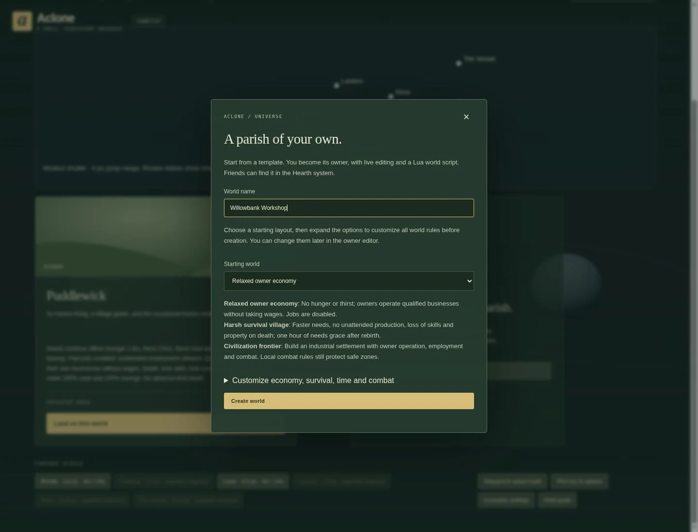

Choose a different preset when its rules suit your idea:

- **Living economy village:** trading, employment and survival.
- **Harsh survival village:** stronger survival pressure and harsher consequences.
- **Civilization frontier:** a settlement with employment, owner operation and combat.
- **Team deathmatch arena**, **Capture the flag arena**, or **Capture point arena:**
  a sporting starting point with needs disabled.
- **Vehicle playground:** vehicle experiments without building an economy first.
- **Blank creator canvas:** a quieter starting layout. It removes village businesses
  except the spaceport; it does not remove the terrain or every activity landmark.

To override a preset before creation, expand **Customize economy, survival, time
and combat**, tick **Use these custom rules**, and change the fields. Later, use
**Rules**. A host allows up to eight worlds per owner and 100 worlds in total.

**Edits are live.** A Save or Apply action changes this world for its visitors;
there is no separate Publish button. Test here before changing a populated world.
Export a design before major changes. The world creator has editing authority;
ordinary visitors do not gain it by entering the world.

## 2. Find the right tool

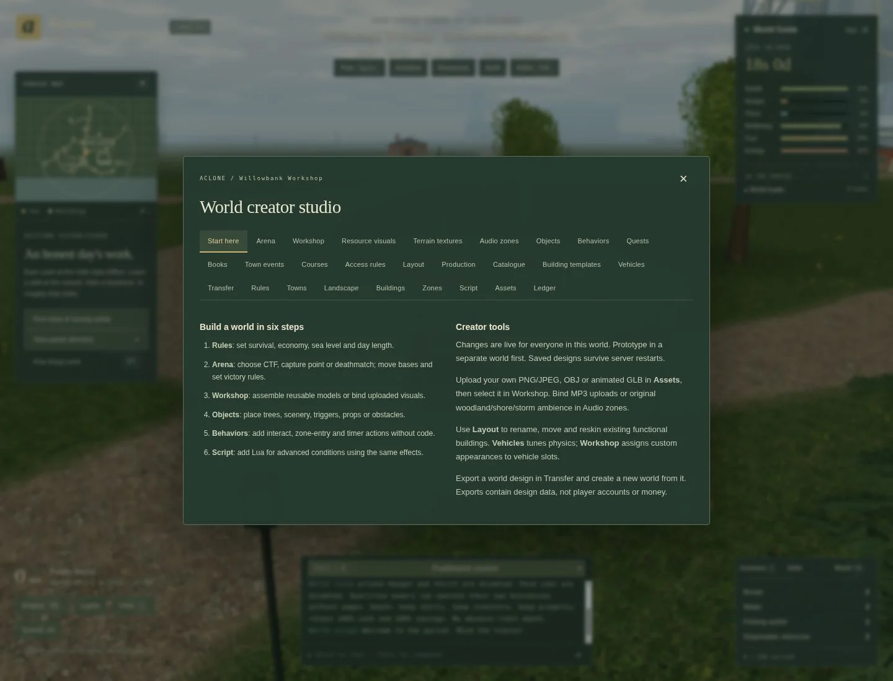

The editor has several kinds of tools. Their roles are different:

- **Rules**, **Towns**, **Arena**, **Courses** and **Zones** define how play works.
- **Landscape** changes ground, paths and barriers. **Layout** moves existing
  buildings and controls generated scenery and weather.
- **Workshop** makes reusable visual models; **Objects** places instances of them.
  **Assets**, **Terrain textures**, **Resource visuals** and **Audio zones** add media.
- **Buildings** places functional businesses or opens caretaker administration.
  **Production**, **Catalogue** and **Building templates** define their economy.
- **Behaviors**, **Quests**, **Books**, **Town events** and **Access rules** add
  interactions and progression. **Script** adds Lua when the forms are not enough.
- **Vehicles** changes vehicle handling. **Transfer** exports/imports designs.
  **Ledger** helps inspect money movements.

A house-shaped object is scenery until you give it behavior. It does not become a
home or shop merely because it looks like one. Likewise, changing a building's
visual model does not change its recipe or prices.

## 3. Choose rules players can understand

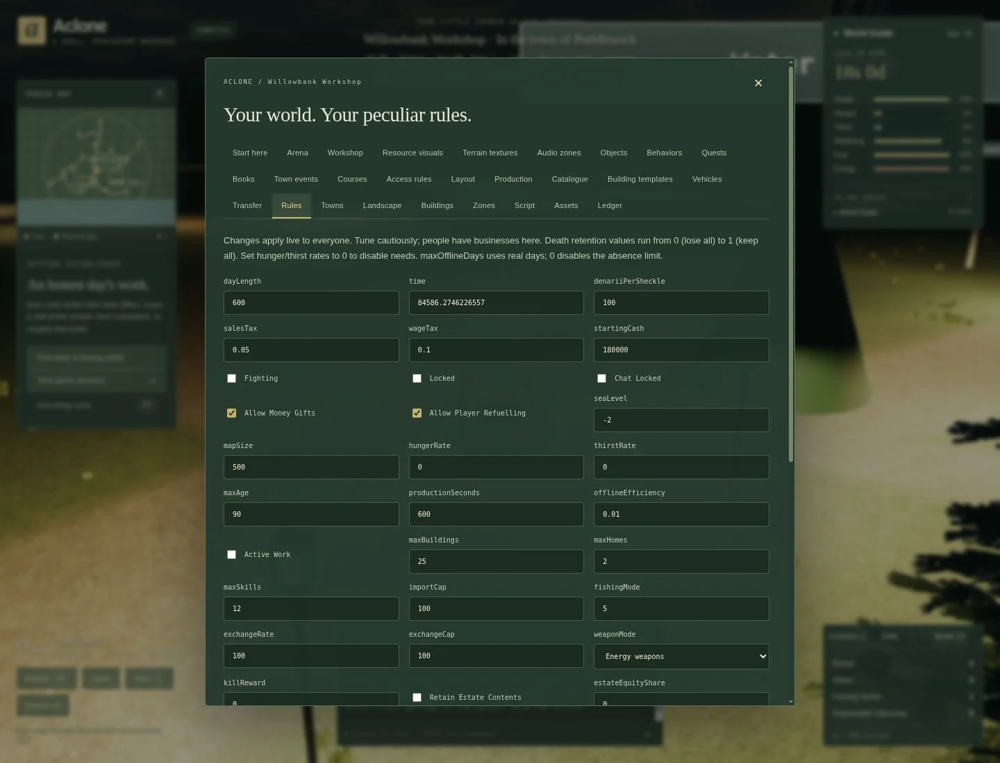

Open **Rules**. Change only a few settings at a time, then use its save button.

**Boats and death** is a dedicated group at the top. Tick **Lose all owned boats
on death** for Puddlewick-style loss of boats, cargo, provisions and tank fuel,
including stored boats. Untick it to allow recovering an offshore boat after death.
In recovery worlds, choose the cargo lifetime in **game days** (five by default;
zero means no spoilage) and whether tank fuel survives. For example, untick boat
loss, enter `5`, and tick fuel retention to give captains five game days to retrieve
their cargo while keeping their vessel and fuel. These rules are independent of
personal inventory loss; running out of fuel still permits recovery either way.

For a first creation, leave most preset values alone.

- **Map Size** is the square world's side length in metres, from 500 to 20,000.
  Larger worlds have generated countryside beyond the village. This is a finite
  island world, not an infinite Minecraft-style map.
- **Hunger Rate** and **Thirst Rate** set survival pressure; zero disables the
  corresponding need. Needs and health can continue changing while players are offline.
- **Max Offline Days** is a separate absence limit measured in real days;
  zero disables that limit.
- Death switches independently control loss of skills, inventory, jobs and
  property. Cash and bank retention use fractions: `1` keeps everything, `0`
  keeps nothing. Ordinary death does not erase loans.
- Employment rules determine whether workers must renew shifts, whether jobs
  count while offline, and whether qualified owners may operate without wages.
  Make those rules clear to players before asking them to run a business.
- **Fighting**, weapon settings and safe zones determine where combat is possible.
  An arena is not a reason to enable unwanted combat throughout an economy town.

Read units carefully. Many ordinary shop/editor price fields are in **denarii**;
raw data and some explicitly labelled course/rule fields use **hundredths of a
denarius** (`100` means `1d`). Distances are metres; editor rotations are degrees.
The decorative day/night clock is separate from the farming/calendar clock, whose
game day is 600 real seconds. Changing the sky clock does not speed up every game system.

## 4. Shape the landscape

Open **Landscape**. Its north-up preview shows the central 500 × 500 metre village,
even when your world is larger. Coordinates use X across the map and Z down the
map; `(0,0)` is the centre. For points beyond the preview, enter coordinates rather
than assuming the little map shows the whole world.

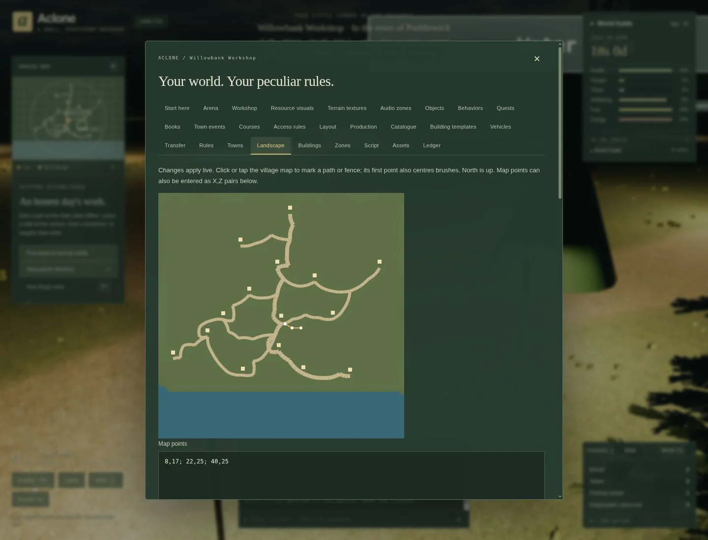

### Example: a path to the water tree

1. Click three points on clear ground near the centre. Our example uses approximately
   `8,17`, `22,25`, and `40,25`. Check your own terrain and buildings first.
2. Scroll to **Paths and barriers**. Choose **Curved gravel path**, width `3`.
3. Click **Add path or barrier**. The path is saved and appears in the world.
4. Close the editor and drive along it. Check both ends are accessible.

**Map points** also accepts semicolon-separated X,Z pairs, for example
`8,17; 22,25; 40,25`. Finish editing the field before submitting. At least two
points are required for a line. Use **Clear points** before beginning another feature.

Use the same line tool for a **Straight gravel path**, **Timber fence** or
**Stone wall**. Barriers are physical obstacles: leave gaps for entrances and test
whether a tractor can turn through them. Paths appear on maps and receive streetlights.

### Ground, vegetation and heightmaps

- **Surface brush:** paint a circular grass, gravel, soil or sand patch. This
  changes the ground surface; it does not create a harvestable resource deposit.
- **Scatter Workshop models:** choose a saved tree/rock model, radius, count and
  seed. Scatter avoids roads, buildings, water and overlaps, so a crowded area
  may contain fewer instances than requested. Tick **Solid obstacles** deliberately.
- **Raise or lower ground:** enter X, Z, radius and a signed height change.
  Start with a broad radius and a small height change. Negative values lower ground.
- **Heightmap import:** upload a PNG/JPEG; black maps to the low height and white
  to the high height. **Preview heightmap**, inspect the blue submerged areas, then
  **Apply previewed heightmap**. It replaces the base terrain but retains height brushes.

Heightmaps are sampled to 33 × 33 points across the entire map, so very large
worlds have coarse spacing. Keep roads and building sites gentle: new construction
rejects footprints with more than 2 m of ground-height variation. Editing terrain
under an existing building can still leave bad access; inspect it afterwards.

**Undo last landscape edit** retains four recent path/surface/scatter/heightmap
changes. Remove individual height brushes in **Layout**. Export is your recovery
point for changes beyond this limited undo history.

## 5. Make and place an interactive object

This example makes a tree that supplies one carried Water per interaction, with a
30-second cooldown. It demonstrates three separate steps: **model → object → behavior**.

### Make the model in Workshop

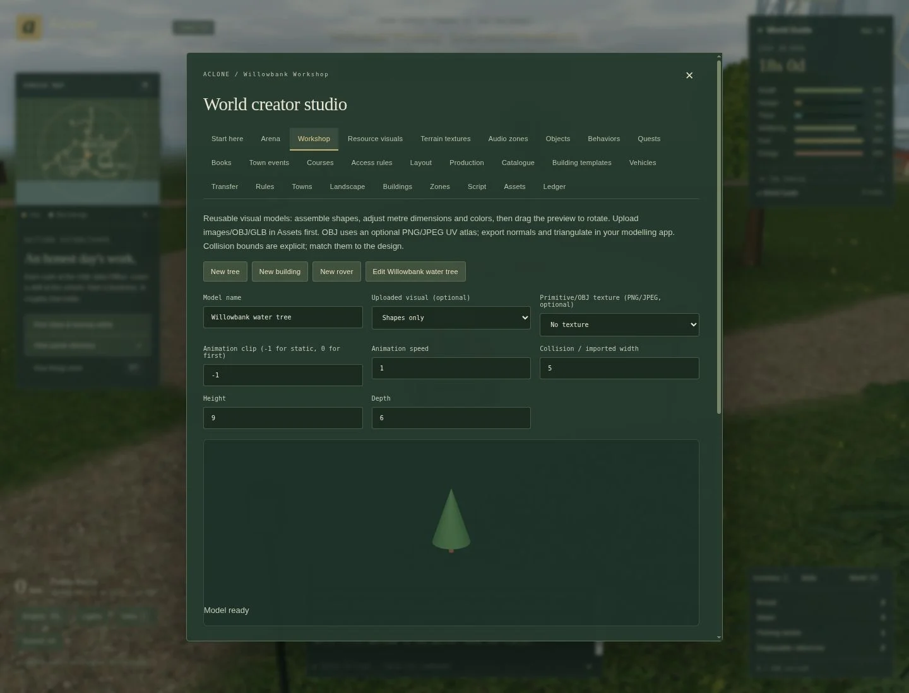

1. Open **Workshop**, choose **New tree**, and name it **Willowbank water tree**.
2. Keep the starter cylinder trunk and cone foliage for this first example.
3. Expand a **Part** to edit its shape, colour, position, dimensions and rotation.
   Use **Add shape** for another box, cylinder, cone or sphere.
4. Drag the preview to see another angle. Keep the collision/imported width,
   height and depth consistent with the visible object.
5. Click **Save model**. Saving a model alone does not place it in the world.

Simple shapes with detailed textures are usually a better choice than dozens of
tiny parts. The workshop allows 32 parts per model and 64 models per world.

### Place an instance in Objects

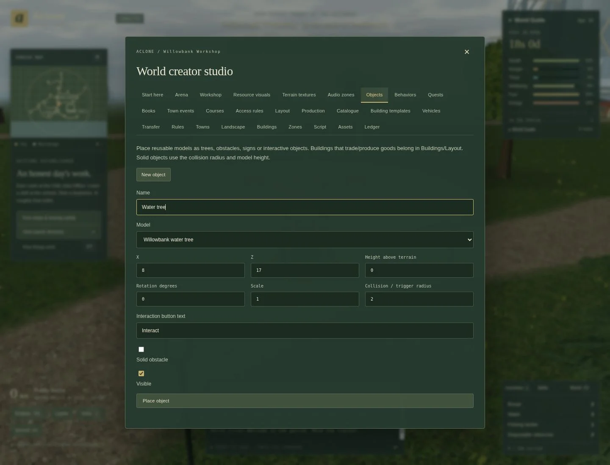

1. Open **Objects**. Select **Willowbank water tree** as the model.
2. Set **Name** to **Water tree** and choose clear ground near your arrival point.
   The screenshot's example is X `8`, Z `17`; your world may need another location.
3. Keep height above terrain `0`, scale `1`, and a collision/trigger radius of `2`.
4. Set **Interaction button text** to **Collect water**. Leave **Visible** on.
   For this tutorial, leave **Solid obstacle** off so nobody gets trapped.
5. Click **Place object**. Later select its name to update, duplicate or remove it.

### Give it behavior

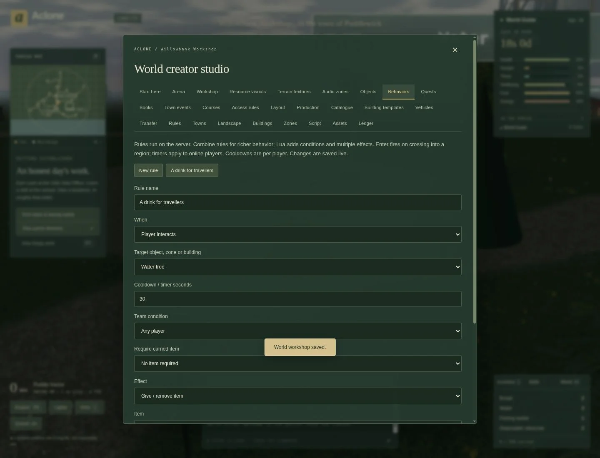

1. Open **Behaviors**. Name the rule **A drink for travellers**.
2. Set **When** to **Player interacts** and **Target object, zone or building** to
   **Water tree**. Do not leave an interaction rule's target blank.
3. Set **Cooldown / timer seconds** to `30`, **Team condition** to **Any player**,
   and leave **Require carried item** as **No item required**.
4. Choose **Give / remove item**, item **Water**, quantity `1`.
5. Keep **Rule enabled** checked and click **Save behavior**.
6. Close the editor, approach the tree, click it or use the nearby **E/Ctrl**
   interaction, and choose **Collect water**. Check that your inventory gains Water.
   Try again immediately: the cooldown prevents another grant.

This creates a supply, rather than buying Water from a business or drinking it
immediately. In a survival economy, an unlimited free water source changes the
market; use this example as a tutorial aid or deliberately balance its availability.

Other triggers are **Player enters region**, **Repeat timer**, **Player arrives**
and **Player finishes a task**. Effects include messages, health/needs changes,
teleportation, team score and object visibility. Multiple rules on one trigger can
combine effects. Cooldowns are per player and reset on restart/design save; timer
rules concern online outdoor players, not unlimited offline production.

## 6. Place buildings and make an economy

**Buildings** places functional buildings and lists **Manage existing buildings as
caretaker**. Use that explicit caretaker path to adjust somebody else's shop;
ordinary Building Admin controls still respect personal ownership.

**Layout** selects an existing building, then changes its name, X/Z, rotation and
visual model while retaining its business, owner and inventory. A custom visual's
dimensions also define its footprint. Occupied homes and buildings with running
tasks cannot be moved until they are clear.

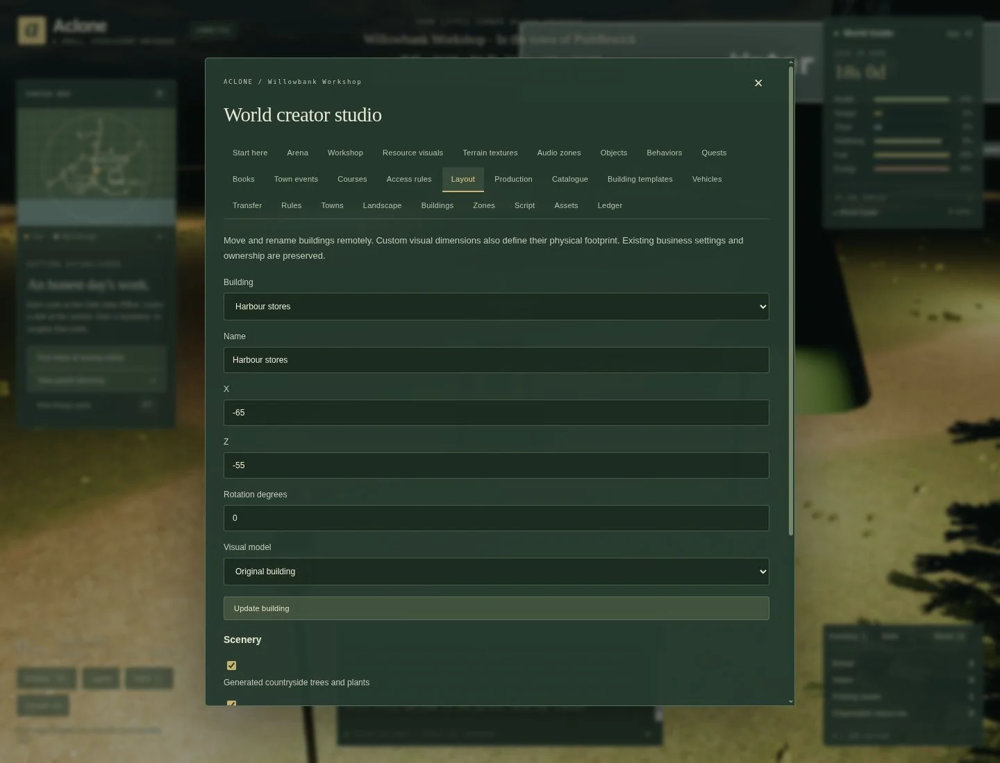

Players constructing normally use **Build**: choose architecture, finish and a
supported size, rotate the preview, review materials and cost, and place it on
suitable ground. The [building gallery](https://nogits.com/buildings/) previews the
built-in designs. Larger premises need more space and materials; not every type
has three size choices. Waterworks must be on a suitable shoreline.

### Example: check the farm-to-mill-to-bakery chain

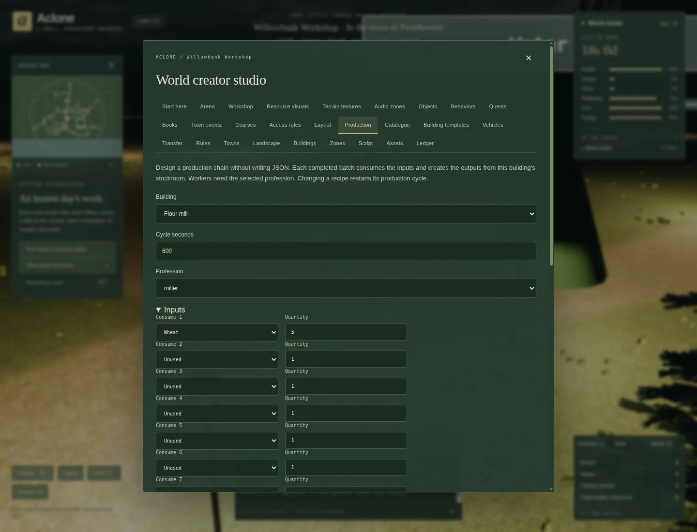

1. Open **Production**, choose **Flour mill**, and inspect its recipe. A standard
   batch uses 5 Wheat to produce 3 Flour, with a 600-second interval and a miller.
2. Expand the input/output lists and leave unused rows as **Unused**. Save only
   when you intend to change the recipe: saving restarts batch progress.
3. Scroll to **Production chain check**. Compare input costs, output value, tax,
   wages and available suppliers. A positive estimate is necessary, not a promise
   that somebody will buy the output.
4. Through **Buildings → Manage existing buildings as caretaker**, inspect the
   farm's selling price, mill's Wheat buying price, mill's Flour selling price,
   and bakery's Flour buying price. Leave a margin for a player hauling between them.
5. Check the mill actually has Wheat, room for Flour and sufficient capital for
   wages and purchases. Repeat for the bakery and its downstream buyers.
6. Test a real batch and a real sale before copying this chain across the world.

A building needs more than a recipe. It needs inputs, output capacity, appropriate
staffing or permitted owner operation, working capital, and customers. Too few or
too many active workers reduce efficiency relative to the ideal crew. Farms keep
their crop plots instead of using this generic recipe editor; winter kills crops
left unharvested. Do not use a summer-only crop as the sole year-round source of a necessity.

### Custom goods and professions


In **Catalogue**, try a custom item called **Herbal tea** with stable ID
`custom:herbal_tea`, cargo weight `1`, reference price `10` denarii, and modest
thirst relief. **Save item**. A reference price does not stock a shop or set every
shop's quotes; wire it into recipes, shop prices, rewards or behavior effects.

Below the items, create a profession such as `custom:tea_blender`, choose tuition,
lesson seconds and any prerequisites. Schools can then teach it. Custom items and
professions stay within this world; built-in definitions are not overwritten.
Definitions that are still referenced cannot be deleted.

### Reusable business templates

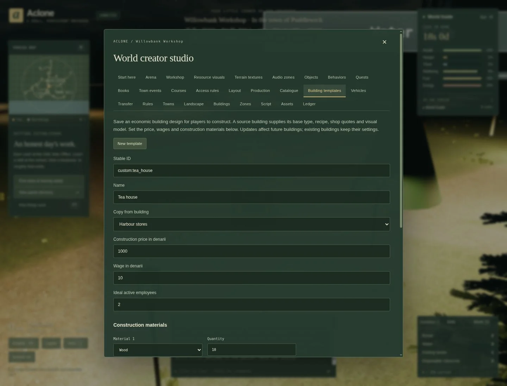

To make a buildable tea house:

1. Configure a suitable source business's recipe, quotes and optional custom visual.
2. Open **Building templates**, choose that source and a stable ID such as
   `custom:tea_house`. Name it **Tea house**.
3. Set construction price, wage, ideal active employees and up to eight construction
   materials. Use plausible ingredients such as Wood, Gravel and Stone blocks.
4. **Save building template**, then find the new option in the normal Build menu.

Template recipes, prices and material bills mainly affect future buildings.
Existing businesses keep their economic settings; ideal crew size is resolved
from the template and can affect existing template buildings too. Test changes
on a fresh copy instead of assuming all existing buildings were upgraded.

## 7. Import artwork and build atmosphere

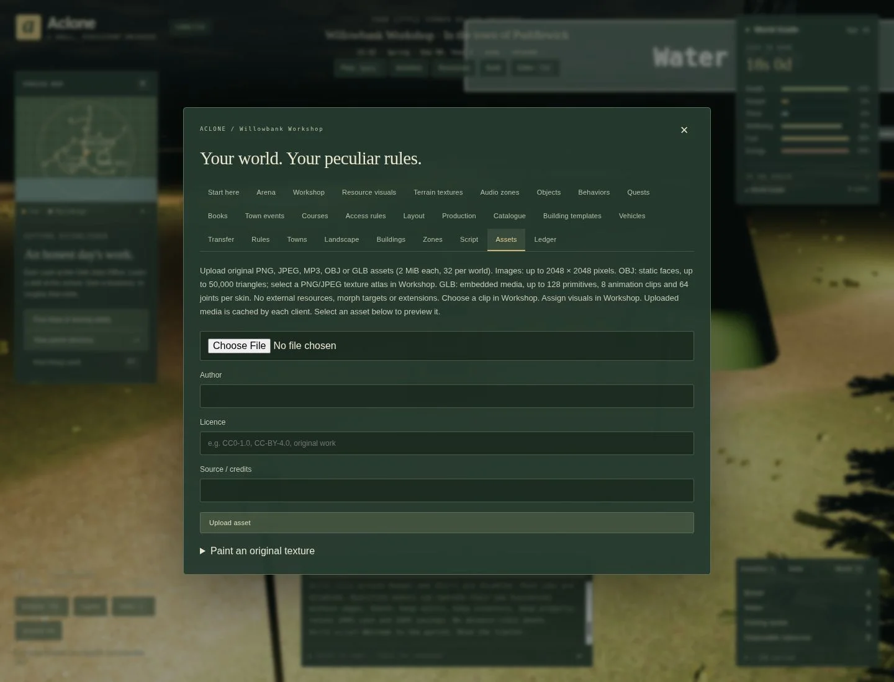

Use **Assets → Upload asset** for original or licensed PNG/JPEG, OBJ, GLB or MP3
files. Fill in author, licence and source credits. Uploading does not place or
assign an asset; select it in the relevant editor afterwards.

- **OBJ:** export a triangulated static mesh with normals and UVs. Upload the OBJ
  and one PNG/JPEG texture atlas separately. In Workshop choose the OBJ under
  **Uploaded visual**, and the image under **Primitive/OBJ texture**.
  External `.mtl` files and remote textures are not fetched.
- **GLB:** use a self-contained file with embedded textures. In Workshop choose an
  animation clip (`0` for the first, `-1` for static) and playback speed when needed.
- **Images:** use as an upright panel, a primitive/OBJ texture, or a supported
  terrain texture. **Paint an original texture** provides an in-game alternative.
- **Resource visuals:** assign a saved model to a resource's appearance. This
  does not create a new deposit or change its quantity/yield.
- **Terrain textures:** assign an uploaded tile to a terrain surface. Test repeats
  at driving height; a photograph that looks good once may tile badly.

Keep uploads small: 2 MiB per file, 32 assets per world, images at most 2048 × 2048.
OBJ has a 50,000-triangle limit; GLB has additional geometry/animation limits in the
[creator reference](WORLD_BUILDING.md#practical-limits-and-extension-points).
Visitors download assigned assets automatically and may see placeholders while
loading. Test on a phone as well as a powerful desktop.

### Add sound and weather

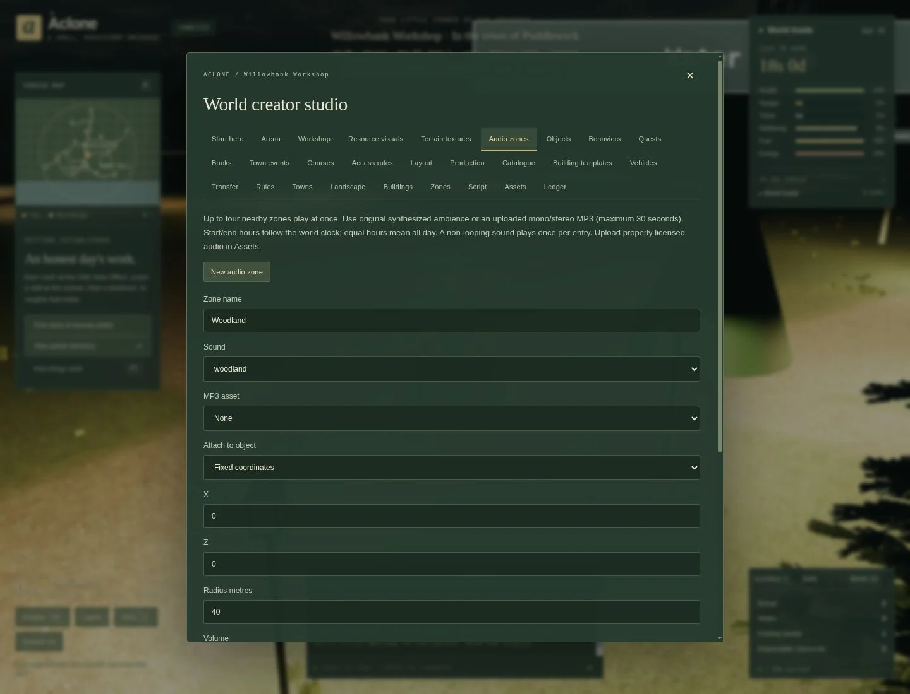

In **Audio zones**, name a zone **Willowbank woods**, choose **woodland**, position
it near your trees, use radius `40` and volume `0.35`, and keep looping on. Save,
close the editor and enter/leave its radius with sound enabled.

You can instead bind an uploaded mono/stereo MP3 up to 30 seconds long, attach a
sound to an object, or restrict it by clock hours and weather. Equal start/end
hours mean all day; a non-looping clip plays once per entry. At most four nearby
zones play together. A hidden object does not emit its attached sound.

In **Layout → Scenery**, choose natural weather or a fixed condition and toggle
generated countryside vegetation and roads/streetlights. Weather also affects
traction, snow and crops. Snow accumulates in layers; only
sunny daylight melts it, and winter keeps a thin base until spring. Roads remain
clear. See [weather rules](PLAYING.md#time-and-weather).

## 8. Teach players with quests, books and events

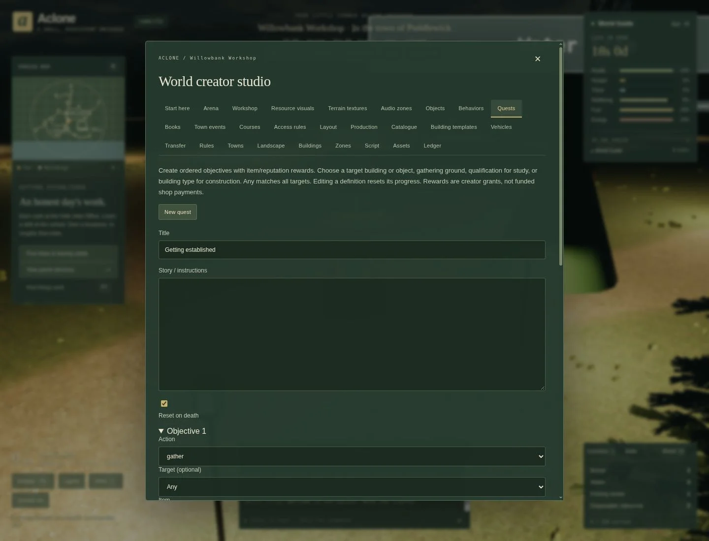

### Example: visit the water tree

1. In **Quests**, give the quest the title **Welcome to Willowbank** and instructions
   explaining where the Water tree stands.
2. In **Objective 1**, choose action **interact**, target **Water tree**, quantity `1`.
   Leave the item filter unrestricted and all other objectives unused.
3. Give a small reputation reward, and optionally one Bread. Choose whether death
   resets progress, then **Save quest**.
4. As a player, open **World / F9 → Quests**, accept it, and only then interact with
   the tree. Confirm progress and claim the reward with room in your inventory.

Objectives are ordered; actions taken before acceptance do not count. Editing a
quest resets its progress. Claims cannot be repeated, and item rewards are creator
grants rather than purchases from a shop. More advanced tutorials can sequence
buying, gathering, studying, taking a job and completing construction.

**Books** attaches up to eight pages of text to a carried item. Create a custom
handbook item in Catalogue, bind pages in Books, then distribute it through a shop
or reward. Players use **Inventory → Read**; reading does not consume the item.
Do not bind your handbook to a common item unless every instance should offer that book.

**Town events** announces festivals or markets and can link an existing quest.
Choose a first day, duration and repeat interval; repeat `0` means once. Days count
from world creation. An announcement does not change shop prices or create prize
money; arrange those separately. Missed announcements are not replayed after downtime.

**Access rules** gates an action before it takes effect. For example, require a
qualification before taking a particular job, and explain the restriction in plain
language. Select the specific target so you do not accidentally restrict every
shop. All configured conditions must pass, for humans and NPCs alike. Required
carried items are checks, not automatically consumed entry fees.

## 9. Design arenas and driving courses

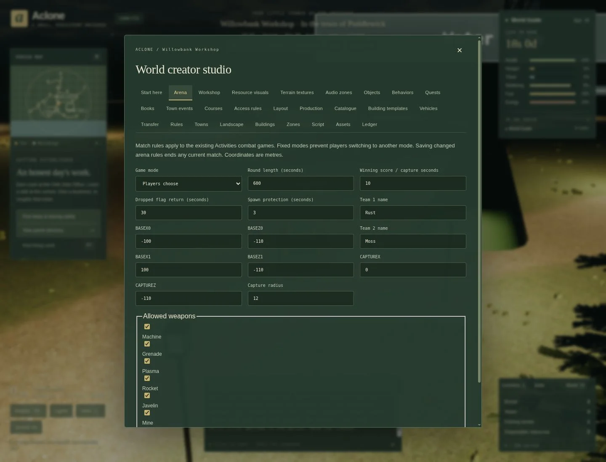

### Capture-the-flag example

Use a separate **Capture the flag arena** world for this exercise.

1. In **Arena**, select **Capture the flag** as Game mode. Give both teams clear names.
2. Put their bases on reachable land at least 20 m apart. For a compact practice
   arena, try X `-80`, Z `0` and X `80`, Z `0`, after checking the sites.
3. Start with a 600-second round, winning score `3`, a 30-second dropped-flag return
   and 5-second spawn protection. Select suitable allowed weapons.
4. Save the rules. A changed arena configuration ends the current match.
5. Use **Objects** for cover and **Zones** for safe or no-construction areas.
   Do not put the entire fighting space inside a safe zone.
6. Have two players join through **Activities**. Test both spawn points, capture
   routes, flag return and scoring—not only the owner's view.

**Players choose** leaves several activity modes available; a fixed game mode
restricts joins to that mode. Marker zones alone do not invent a complete game:
use Arena for match rules and Behaviors/Script for custom interactions.

### A checkpoint driving course

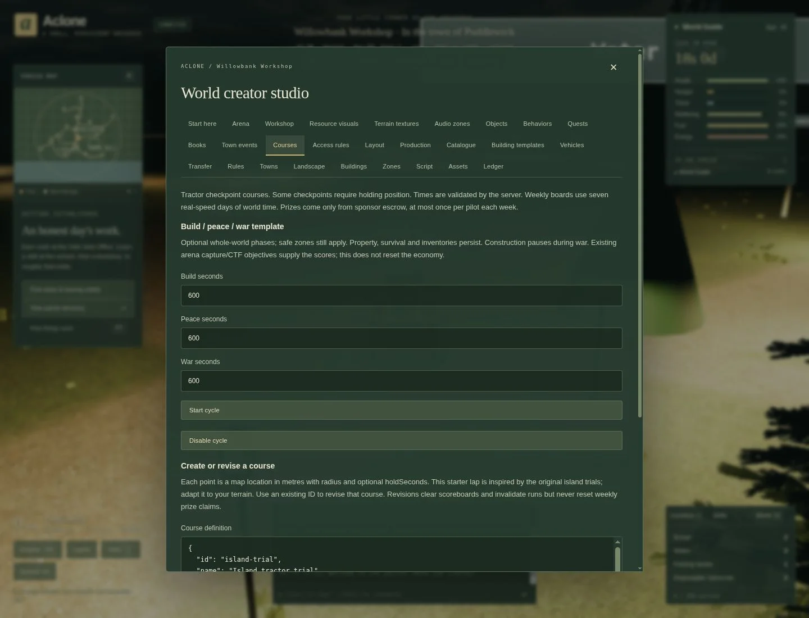

Open **Courses** and scroll to **Create or revise a course**. It provides editable
JSON, not a map-drawing tool. Start with the supplied example, change its ID and
name, and inspect each point's X/Z, radius and optional `holdSeconds`.

A course needs 2–32 checkpoints and a 10–3600-second time limit. Consecutive
checkpoints must not overlap. Opening and closing times are seconds of world time;
choose a window that is still in the future/current when players try it. Drive the
route before offering a reward, then use **Start course** and its next-checkpoint
waypoint. A five-second hold makes a useful precision-parking checkpoint.

Rewards use sponsor-funded escrow, not free money. Funding and unused escrow
collection are in the course panel. Revising a course clears scoreboards and
invalidates active runs; weekly reward claims are retained.

The optional **Build / peace / war** controls alternate construction and fighting
phases. Construction pauses in war; combat is off in build/peace, and safe zones
still apply. Property, inventories and survival persist between rounds. This is
not an automatic economic reset.

## 10. Towns, vehicles and advanced scripting

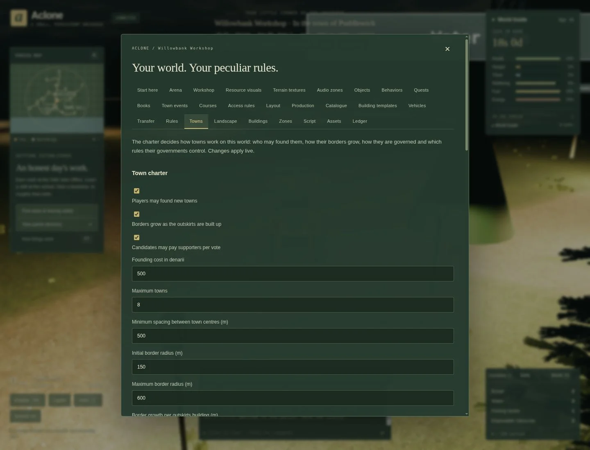

**Towns** edits the world charter: who may found a town, cost and required skill,
town limits and spacing, border growth, permitted forms of government, zoning,
tax caps, election timings and residency requirements. Start with one town and
short travel distances. A charter sets the possibilities; it does not automatically
produce prosperous towns or run elections on behalf of players.

Players govern through each town's plinth. The caretaker can also adjust town
rules or appoint a mayor there. Decide whether construction outside borders is
allowed, governed by the nearest town, or forbidden before inviting builders.

**Vehicles** edits a slot's speed, acceleration, steering, armour and fuel settings.
**Workshop → Use as a vehicle** changes its appearance. These are separate: assigning
a boat-shaped model to a tractor slot does not turn the tractor into a boat. Test
handling, cargo and entrances after tuning, especially on hills and narrow roads.

### A small Lua example

Open **Script** when no-code behaviors no longer express your idea. This example
counts visits and posts a welcome on arrival:

```lua
on("PlayerLogin", function(e)
  setvar("visits", getvar("visits") + 1)
  announce("Welcome to Willowbank. Visit the water tree beside the path.")
end)
```

Choose **Validate & reload Lua**, then reconnect a test visitor to trigger it.
Reloading the script alone does not simulate a login. Avoid constant timer
announcements: players should be able to talk without the world interrupting them.

Lua runs on the server with strict limits and no filesystem/network access.
Persist numbers with `getvar`/`setvar`; ordinary Lua globals do not persist between
events. Use **Access rules** for checks that must stop a trade/build/job before
money or inventory changes. The [scripting guide](SCRIPTING.md) lists supported
events, functions, cooldown examples and failure behavior; arbitrary Lua libraries
or historical A Tractor commands are not automatically available.

## 11. Test, export and share

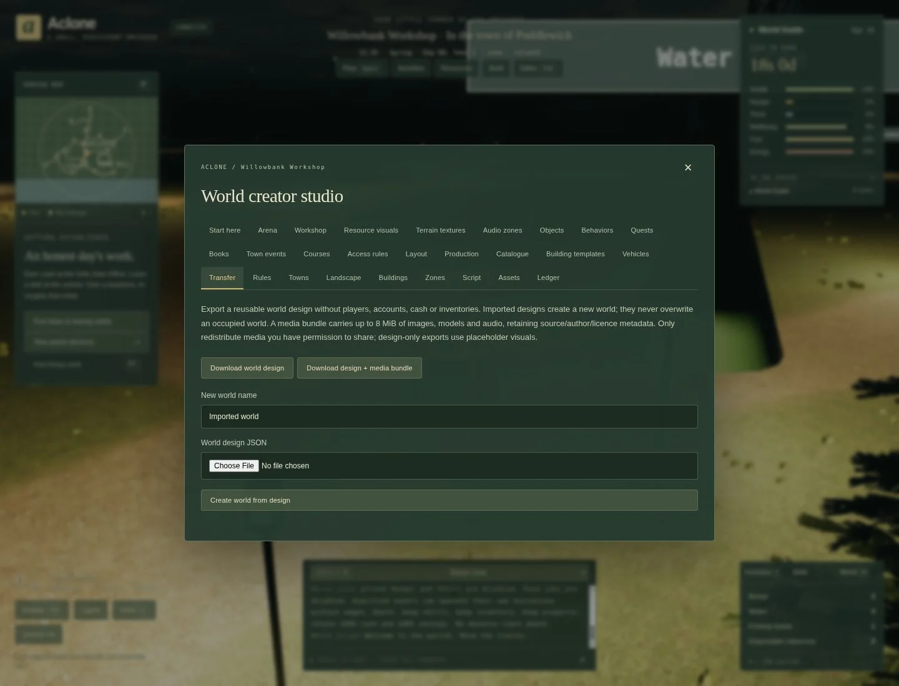

Before inviting people, play as a visitor without caretaker privileges:

- Can a newcomer find food, water, fuel and somewhere safe to stay—or are needs disabled?
- Can they reach every required shop, object and checkpoint in an ordinary vehicle?
- Do interactions, quest acceptance/rewards and restrictions give clear feedback?
- Can the production chain acquire inputs, pay staff and sell outputs?
- Do your custom models load, collide sensibly and run smoothly on a phone?
- After reconnecting, are saved designs present and the rules still understandable?

Use **F6 → Caretaker dashboard** for player/building condition and public chat/notices.
Use **Ledger** for recent money movements and its JSON download. Watching those
results is more useful than assuming a good-looking village has a functioning economy.

In **Transfer**, choose:

- **Download world design:** a small design file for rules, terrain, models,
  objects, behaviors, scripts, building layouts and economic definitions.
- **Export design + media:** also includes validated media and credits, within
  an 8 MiB media budget. Use this for an artwork-based world you intend others to host.
- **Create world from design:** imports into a separate world, not over the world
  you are standing in. Test an exported copy before distributing it.

Designs do **not** contain player accounts, chat, cash, inventories, business stock
or investment, saved quest progress, course funds/scores, or script variables. A
plain design file also does not carry uploaded media; expect placeholders until
assets are reassigned. This is a reusable world design, not a full server-save backup.
For disaster recovery, use the host's database/assets backup procedure.

Share the world name and its host with players; they can find it in that host's
galaxy directory. Share an exported bundle with other world builders only when you
have permission to redistribute its artwork and audio. Keep the example small,
watch people play, then expand the parts they enjoy.

## Troubleshooting

- **I cannot edit:** create your own world or check caretaker authority. Owning a
  cottage or being a town mayor does not automatically grant world editing rights.
- **The model is saved but invisible:** save an Objects instance or assign the model
  to a building/vehicle; confirm visibility, coordinates and scale.
- **The tree does nothing:** check the behavior's target, enabled state, item/team
  requirements, distance, cargo space and cooldown. The model name and instance
  name are separate.
- **A path says it needs two points:** mark at least two points in the current
  Landscape session; do not rely on an old text draft after switching tabs.
- **The object looks solid but I drive through it:** check its solid flag and
  collision radius/bounds. Appearance alone is not collision.
- **My factory does not produce:** check skill, active crew, work rules, investment,
  input stock, output capacity and the batch interval before changing the recipe.
- **Uploaded artwork is a placeholder:** inspect file size/format and Workshop
  assignment; use a self-contained GLB or supported OBJ plus texture, not external URLs.
- **The imported world is empty of money and stock:** that is intentional for design
  imports. Configure starting play and supplies separately, or restore a host backup.

For the complete option inventory and current limits, see the
[creator reference](WORLD_BUILDING.md). For suggestions or examples, use the community's
[world-building channel](https://discord.com/channels/1562183434254680175/1562195371487133746).

## Automatic food and drink

In **Editor → Rules → Automatic food and drink**, configure `autoConsumeInventory` (eat carried supplies online/offline anywhere), `autoConsumeHomeStock` (use the selected owned home or active private guest-room pantry while away), and `homeNeedsMultiplier` (0–1; 0 disables indoor drain, 1 gives no indoor benefit). Home stores always feed occupants automatically. Inventory and remote-home feeding default off for other worlds, preserving existing behavior. Puddlewick enables both once and uses a 0.8 indoor multiplier; later owner edits survive restarts.

Only a valid owned home or unexpired private booking is eligible. Public lodging/business stock and another owner’s supplies are excluded. Boat crew still use their captain’s provisions first; the normal captain rule for boat stores remains offline-only. Inventory feeding also applies to online captains when enabled. The at-home provisions estimate follows these settings and includes carried supplies when available.
